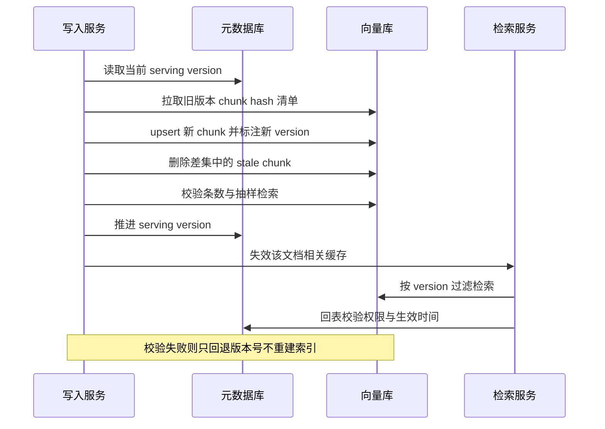

# 知识库更新后旧答案还在被召回：增量索引的差集删除、版本可服务与缓存失效

## 为什么会有这个问题

文档更新在 RAG 里不是「覆盖一个文件」那么简单：一篇文档被切成 N 个 chunk，切分策略一改，chunk 边界和 id 就全变；如果用随机 uuid 作为 point id，upsert 只会新增，旧 chunk 永远留在库里，且因为历史命中多、相似度不差，仍会排到前面。链路上还有三个不一致源：向量库与元数据库（权限、生效时间、租户）双写无事务；向量库删除在分片/压缩下是异步生效的；query 侧的语义缓存与 LLM 缓存不带版本号。最常见的错误认知是「重新 embedding 一遍就等于更新了」，忽略了删除是需要显式算差集的。

## 怎么做

1. 把 chunk id 设计成确定性标识：doc_id + 归一化后的内容 hash（或稳定的段落锚点），内容不变则复用向量，只对新 chunk 付费 embedding，同时天然支持去重。
2. 写入前先取旧版本清单算差集：需要 upsert 的、需要 delete 的、可复用的三份；删除必须显式执行，不能依赖 upsert 覆盖。
3. 用「版本可服务」而不是「原地覆盖」：新 chunk 带 version 与 ingested_at 写入，校验条数与抽样检索通过后再把 serving_version 推进，检索侧统一加 version ≤ serving_version 过滤，失败只回退版本号，不需要重建索引。
4. 元数据以业务库为 source of truth，向量库只存 id、少量 filter 字段和 hash；检索后回表校验权限、生效时间与版本，这同时解决权限即时回收的问题，代价是一次批量主键查询。
5. 缓存全部带版本：语义缓存 key 里拼 index version 或 doc updated_at，发布时按 doc 前缀失效；LLM 回答缓存同理，否则前端会命中旧答案。
6. 建陈旧检测与回归门禁：定期抽查高频 query 的 top-k，断言不包含过期 version 的 chunk；每次发布后用固定评估集跑一遍，专门统计「引用过期内容」的比例。
7. 把快照备份与恢复演练纳入流程：定期验证从对象存储恢复 → 校验点数与抽样检索可用，避免灾难时才发现备份链路配置有坑（如鉴权或协议不匹配）而不可用。

## 关键代码

```python
def diff_chunks(new_chunks, old_hashes):
    new_ids = {c["chunk_id"] for c in new_chunks}
    stale = [cid for cid in old_hashes if cid not in new_ids]
    to_embed = [c for c in new_chunks if old_hashes.get(c["chunk_id"]) != c["hash"]]
    return stale, to_embed

async def publish(doc_id, new_chunks, new_version):
    old = await vdb.fetch_hashes(filter={"doc_id": doc_id, "version": await db.serving_version(doc_id)})
    stale, to_embed = diff_chunks(new_chunks, old)
    await vdb.upsert([to_point(c, doc_id, new_version, await embed(c["text"])) for c in to_embed])
    if stale:
        await vdb.delete(ids=stale)
    await assert_no_stale(doc_id, new_version)
    await db.set_serving_version(doc_id, new_version)
    await cache.invalidate_prefix(f"kb:{doc_id}")
    logger.info("published", doc_id=doc_id, v=new_version, embedded=len(to_embed), deleted=len(stale))
```

## 真实场景

某项目的客服知识库修改了退款政策，运营上传了同名文件，但机器人连续几天仍按旧政策回答，且旧政策说法在引用里带着原文档链接。排查路径：查向量库发现该 doc_id 下的 chunk 数只增不减，新文件被分配了新的 doc_id，旧 doc 的 chunk 从未删除；查网关日志发现大量请求命中语义缓存，缓存 key 只包含 query 文本、TTL 设了数天；查删除接口调用记录基本为零——代码里只有 upsert。进一步看监控，collection 点数持续单调上升。改成确定性 chunk id + 差集删除 + serving_version 推进 + 缓存带版本失效，并加上发布后的陈旧抽样断言，同类问题不再出现。

## 示意图



## 面试官追问

1. **Q：** 为什么不在检索后让 LLM 自己判断内容新旧？

   **A：** 不可靠且不经济：LLM 没有权威的时间基准，遇到冲突文本倾向于自信编造；而且这会把正确性成本压到每次生成上。新旧判定应该由数据层用 version 与 serving 状态保证，LLM 只负责在答案里呈现引用来源，必要时由业务侧显式标注「信息截至某时间」。

2. **Q：** 版本切换瞬间，双写或过滤会不会造成漏召回？

   **A：** 会有窗口期。常见做法有两种：一是短窗口内新老版本都写、检索侧按 version ≤ serving_version 过滤（切换前读老、切换后读新，不会读到写了一半的数据）；二是双读合并后按 doc 级 version 去重。关键是要保证「先写完新、再校验、最后推进 serving_version」的顺序，且校验包含条数、抽样检索和关键 query 回归，失败只回退版本号即可。


来源：https://github.com/guocong-bincai/ai-interview-guide/blob/main/docs/03-rag-system/README.md
