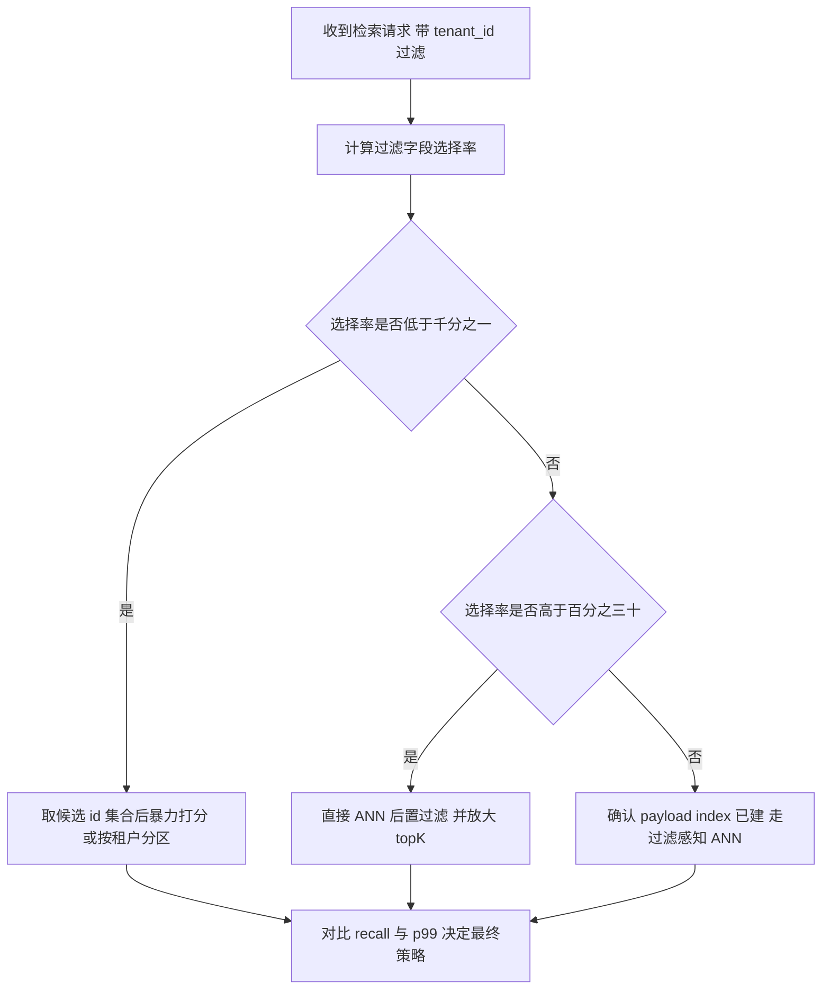

# 加一个 tenant_id 过滤条件后召回明显变差、长尾延迟飙升：filtered search 的执行路径怎么排查，向量库怎么选

## 为什么会有这个问题

向量检索默认是在 ANN 图上做近似最近邻，一旦叠加结构化过滤条件（tenant_id、时间窗、权限标签），执行路径会分叉成三种：post-filter 先取 topK 再过滤、pre-filter 先过滤再在子集上调索引或暴力、过滤感知索引（Qdrant 的 payload index、Milvus 的 partition key 与 scalar index、Weaviate 在低选择率下回退 flat）。常见错误认知是「where 条件只是附加约束，跟召回质量无关」。实际上 post-filter 在低选择率下会把 topK 吃掉大半，返回条数不足就直接变成答非所问；而 pre-filter 在高选择率下退化成全量扫描，p99 随过滤后集合大小线性上涨。更隐蔽的是同一套代码换引擎或升级版本后，默认策略从过滤感知变成后置过滤，线上只有长尾变慢、没人报错。

## 怎么做

1. 先量化两个量：过滤字段的选择率（命中数除总数）和基数（不同取值个数）。按选择率分档决定执行路径，而不是一套参数打天下。
2. 在引擎侧确认执行计划：Qdrant 看过滤字段是否已建 payload index 以及 collection 是否使用 payload_m 分片；Milvus 看是否用 partition key 或 scalar index；Weaviate 观察是否发生 flat 回退。未建索引的高频过滤字段基本等于全量扫描。
3. 构造三组压测集：无过滤、高选择率（大于百分之十）、低选择率（小于千分之一），用 scroll 全量打分作为 ground truth，同时记录 recall@k 与 p95、p99。
4. 低选择率场景补兜底：把 topK 按一除选择率放大后再截断，或对大租户单独走 partition 或 candidate id 集合上的暴力打分（候选少于几千条时暴力远快于走图）。
5. 若租户数可控且跨租户查询不存在，考虑按租户拆 partition 或 collection；租户数到千级以上则回到单 collection 加 partition key，避免元数据管理成本失控。
6. 把过滤字段写进索引设计规范：只对高基数且高频过滤的字段建 payload index，避免全字段索引带来的写入放大与内存膨胀。

## 关键代码

```python
import time
from qdrant_client import QdrantClient, models

client = QdrantClient(url=QDRANT_URL)
COLL, K = "docs", 10

def run(vec, flt, ef=128):
    t = time.perf_counter()
    pts = client.query_points(COLL, query=vec, query_filter=flt, limit=K,
                              search_params=models.SearchParams(hnsw_ef=ef)).points
    return [p.id for p in pts], (time.perf_counter() - t) * 1000

def ground_truth(vec, flt, cap=50_000):
    recs, _ = client.scroll(COLL, scroll_filter=flt, limit=cap, with_vectors=True)
    scored = sorted(((dot(vec, r.vector), r.id) for r in recs), reverse=True)
    return [rid for _, rid in scored[:K]]

for name, flt in [("no_filter", None),
                  ("wide", tenant_filter("big")),
                  ("narrow", tenant_filter("small"))]:
    got, ms = run(Q, flt)
    gt = ground_truth(Q, flt)
    print(name, round(len(set(got) & set(gt)) / K, 3), round(ms, 1))
```

## 真实场景

某项目把知识库从单租户扩成多租户，检索请求固定带 tenant_id 过滤，topK 取 10。上线后出现的现象是：小租户经常只返回两三条、问东答西；同时 p99 从几十毫秒抬到几百毫秒，长尾全部集中在文档量最大的几个租户。排查路径：先算选择率，发现头部租户不到千分之一、长尾租户超过百分之三十；再在引擎侧确认过滤字段没有建 payload index，实际走的是后置过滤，低选择率下 topK 被过滤得所剩无几，而大租户又把 topK 放大后触发了更宽的图遍历。最终按选择率分档：头部租户改 partition，小租户走候选集合暴力打分，中间档补 payload index 并对齐 hnsw_ef，召回与 p99 同时回到基线。

## 示意图



## 面试官追问

1. **Q：** 为什么不直接无脑放大 topK 解决问题？

   **A：** 放大 topK 只在高选择率下近似有效。选择率为千分之一时，要凑够 10 条需要放大到一万条，网络传输和二次打分开销都跟着涨，而且返回结果里大量是不相关候选，反而稀释上下文。正确做法是先判断选择率落在哪一档，低选择率优先换执行路径（partition、候选集合暴力、倒排先取 id），而不是继续加大 k。

2. **Q：** 什么时候该给每个租户建独立 collection 或 partition？

   **A：** 看三个条件：租户数可控（几百级别）、单租户数据量足够大、且不存在跨租户联合召回。满足时隔离收益明显，召回质量和延迟都稳定，还便于单租户导出与删除。租户数到千级以上，collection 元数据和集群资源会被切碎，应退回单 collection 加 partition key 或过滤字段索引，用查询路由解决隔离。


来源：https://github.com/cdavid817/agent-interview/blob/main/docs/02-capabilities/rag/embedding-vector-1.md
