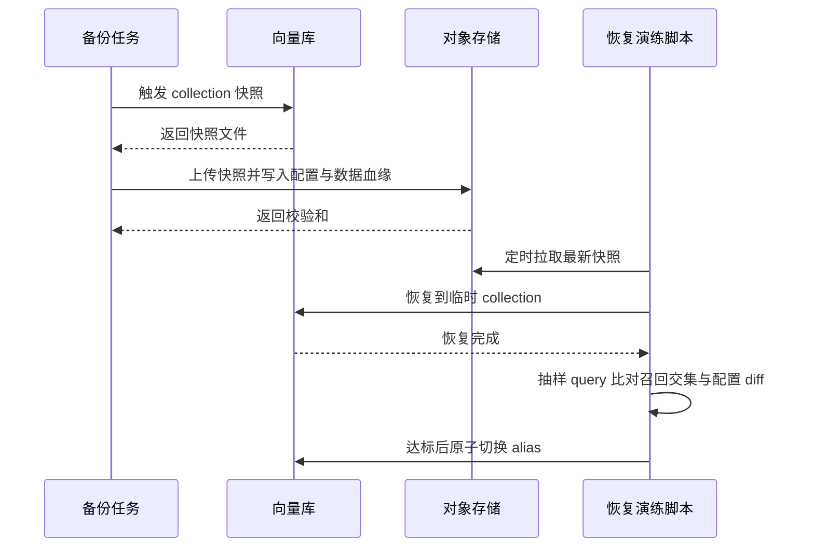

# 备份任务天天显示成功，真要回滚时却恢复不出来：RAG 索引快照的可用性该怎么验证

## 为什么会有这个问题

向量索引的冷备成本和热数据不对称：百万级 chunk 重新 embedding 要数小时到十几小时，还要再付一次 embedding 费用，所以团队普遍依赖索引快照做冷备与回滚。这里有三层错误认知。第一层，备份任务退出码为零就等于可用，实际上传到对象存储时 endpoint、TLS 证书链、凭证配错会在 SDK 内部重试后写空对象或被 except 吞掉，调度器状态依旧显示成功。第二层，快照即数据，但快照不携带外部依赖：embedding 模型版本、chunk 策略版本、collection 的维度与距离度量、payload index 与分区配置、alias 指向，任何一项缺失恢复出来都是另一套索引。第三层，能恢复就等于能用，跨大版本恢复或量化参数不一致时，服务能起来但召回质量已经悄悄劣化，没有任何报错。

## 怎么做

1. 先定 RTO 与 RPO，把重建成本（时间、embedding 费用）和快照恢复成本算清楚，明确哪些 collection 值得备、备份频率多高。
2. 备份产物按三件套存放：快照文件本身、collection 配置导出（维度、distance、量化与索引参数、payload index、分区）、数据血缘（embedding 模型名与版本、chunk 策略版本、源文档处理水位）。三者缺一都不算可恢复。
3. 备份后立即校验：断言对象存储里的快照对象存在且 size 非零、校验和匹配，并且断言上传调用真的返回成功，不允许宽泛的 except 吞异常。
4. 从最新快照恢复到临时 collection，抽一组固定 query 与线上做召回交集比对，同时校验配置 diff 为空，形成可量化的恢复健康分。
5. 线上通过 alias 切流量，代码里禁止写死 collection 名。恢复流程固定为创建、恢复、抽样比对、alias 原子切换四步，比对不通过直接阻断切换而不是调低阈值。
6. 把恢复演练做成周期任务（每次 schema 或模型变更后必跑），记录耗时与召回交集指标；备份任务本身要有对象存在性、耗时、字节数的可观测指标与告警。

## 关键代码

```python
def restore_and_verify(snapshot_url, target, sample_queries, cfg_path, min_hit=0.95):
    assert remote_object_size(snapshot_url) > 0, "snapshot missing or empty"
    client.create_collection(target, vectors_config=load_cfg(cfg_path))
    client.recover_snapshot(target, location=snapshot_url, priority="snapshot")
    wait_until_green(target)
    assert diff_config(target, "docs_live") == {}, "collection config mismatch"

    hits = []
    for q in sample_queries:
        new = top_ids(client.query_points(target, query=q.vec, limit=10).points)
        old = top_ids(client.query_points("docs_live", query=q.vec, limit=10).points)
        hits.append(len(set(new) & set(old)) / 10)
    score = sum(hits) / len(hits)
    if score < min_hit:
        raise RuntimeError(f"restore degraded: {score:.3f}")
    return score
```

## 真实场景

某项目把索引快照传到自建 MinIO，endpoint 写成 https 但证书链不全，SDK 重试若干次后抛异常被一层宽泛的 except 捕获，只打了日志；监控上的「备份成功」取的是调度器任务状态而非对象存储里的实际对象。半年后一次 embedding 模型升级需要回滚，才发现最新可用快照已经是三个月前，且恢复出来的 collection 距离度量与线上不一致、payload index 也没重建，最终只能全量重建、业务停摆半天。排查路径：先看对象存储里快照对象的 size 与最后修改时间，再翻任务日志里被吞掉的 exception，最后对 collection 配置做逐字段 diff，问题链路才完整暴露。

## 示意图



## 面试官追问

1. **Q：** 为什么不干脆放弃快照、每次全量重建？

   **A：** 规模小、chunk 策略还在频繁变动的阶段，重建确实更简单可靠，也省掉快照版本管理。但数据量到百万级后，重建要数小时且 embedding 费用可观，重建窗口内无法回滚、也无法做灰度对比，风险集中在升级时刻。判断依据是重建耗时是否超过可接受停摆时间、以及回滚窗口是否必须存在，而不是一刀切。

2. **Q：** 快照恢复后召回交集差异多少算可接受？

   **A：** 如果索引参数和量化设置完全一致，恢复后图结构应当基本一致，交集接近满分；出现明显差异一般不是索引近似误差，而是配置或数据版本不一致（维度、距离度量、量化参数、payload index 缺失）。所以不应该调低阈值放行，而应把它当成配置漂移信号去修恢复流程。若确实用了 SQ 或 PQ 量化，必须在备份产物里记录量化参数，恢复时严格复用同一套。


来源：https://github.com/qdrant/qdrant/issues/8934
