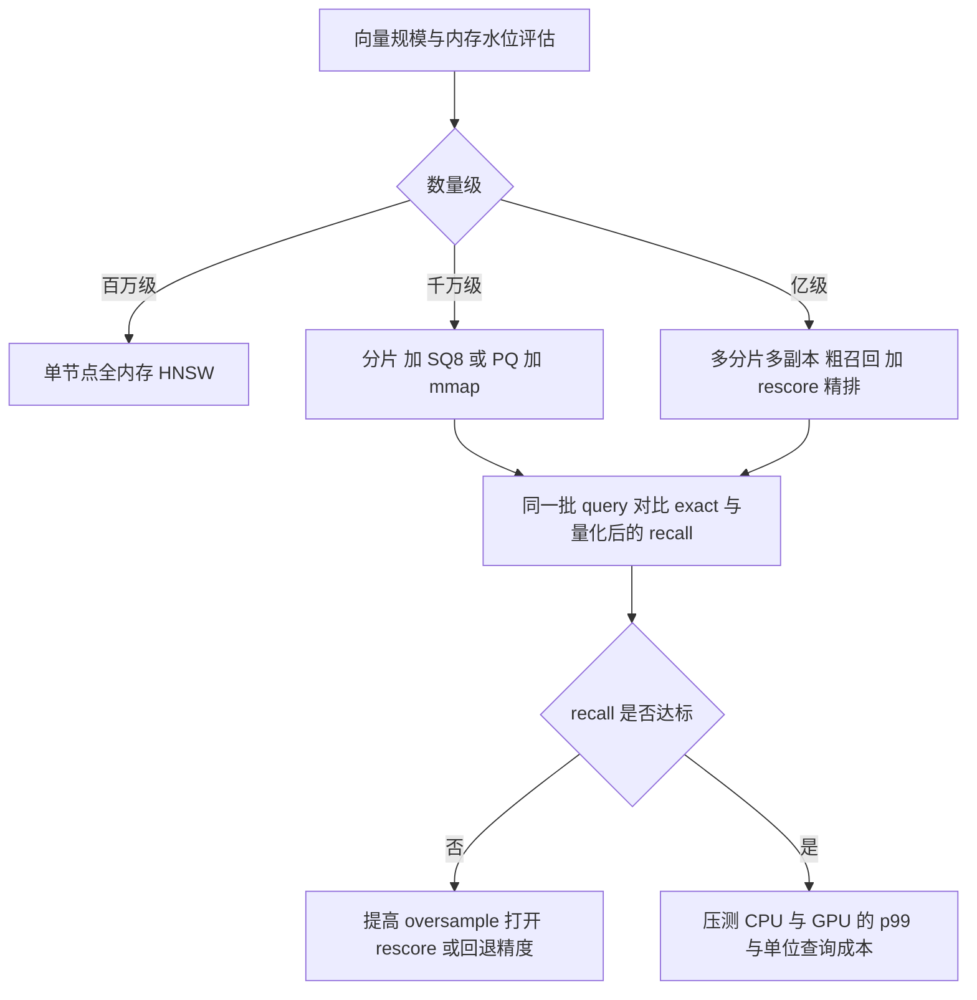

# 索引从百万级扩到亿级后内存打满、recall 下滑：量化与 GPU 的收益边界怎么量化

## 为什么会有这个问题

向量检索的成本上限通常取决于「索引是否放得进内存」，而非峰值 QPS。float32 下裸向量占 N×dim×4 字节，HNSW 还要额外存图结构（与 M 参数成正比），再加副本与段合并的临时放大，实际内存常是理论值的 1.5 倍以上。上量之后必然要动量化（SQ8 / PQ / BQ），但量化会扰动相似度排序，被换掉的往往正是 top-k 尾部那些「差一点」的段落，表现为答案缺漏而不是报错，所以只盯平均延迟会漏掉质量回退。GPU 的收益来自大 batch 并行与高显存带宽，在 QPS 低、batch 只有个位数时，kernel launch 与 H2D 拷贝会把收益吃光；且显存不能超卖，多租户隔离与分片弹性都更差。常见错误认知有三个：把换索引类型当成唯一旋钮；拿平均延迟代替 recall 与 p99；以为换 GPU 就能解决所有慢查询。

## 怎么做

1. 先建容量模型：N×dim×4 字节裸向量 + 图结构开销 + 副本数 + 段合并余量，算出单节点可承载上限，再和实际占用的磁盘、内存水位对照，先找出「非必要占用」（历史向量、未使用的命名向量字段、重复副本）。
2. 按量级选形态：百万级用单节点全内存 HNSW 即可；千万级做分片 + SQ8 或 PQ 量化 + mmap 磁盘索引，把热数据留在 page cache；亿级必须多分片多副本，二值或 PQ 粗召回 + 原始向量 rescore 精排，并按访问频次做冷热分层。
3. 把量化当作带参数的开关而不是一次性决策：固定同一批真实 query，用 exact 检索结果作为上界，对比量化前后与开启 rescore 后的 recall@k，扫描 oversample 倍数（2/4/8），画出「内存节省 vs recall 损失」曲线再定参。
4. CPU 与 GPU 的取舍用同一 recall 目标下的单位查询成本衡量：分别压测空载与带 filter 的场景，记录 p50/p99、每秒可承载查询数、以及索引重建耗时，GPU 一般只在索引构建和高 QPS 大 batch 查询上占优。
5. 加护栏再上线：容量水位、段数量、慢查询比例、以及定期跑的 recall 抽样对比组成监控项；把量化参数和 oversample 写进配置而非代码，便于回退。
6. 上线后按季度复核：数据分布会漂移，原先选定的 oversample 与量化档位在语料变长、变稠密后可能不再达标。

## 关键代码

```python
import numpy as np

def recall_at_k(ref_ids, got_ids, k=10):
    return len(set(ref_ids[:k]) & set(got_ids[:k])) / k

def compare_configs(store, queries, k=10, oversample=4):
    rows = []
    for q in queries:
        ref = store.search(q, limit=k, exact=True)
        sq = store.search(q, limit=k, quant="sq8", rescore=False)
        sq_r = store.search(q, limit=k, quant="sq8",
                            oversample=oversample, rescore=True)
        rows.append([recall_at_k(ref, sq, k), recall_at_k(ref, sq_r, k)])
    mean = np.mean(rows, axis=0)
    return {"sq8": round(float(mean[0]), 4),
            "sq8_rescore": round(float(mean[1]), 4)}
```

## 真实场景

某项目的知识库从百万级文档涨到几千万 chunk 后，节点内存水位长期在 85% 以上，检索 p99 开始出现秒级抖动，同时业务侧反馈「答案里少了关键那条」。排查顺序是：先算理论内存与实际占用的缺口，发现 collection 里为多路召回建了若干个 optional 命名向量，每个都按最大维度占位，实际容量是最小必要集合的数倍；把离线才用到的向量字段迁到独立冷集合后内存回落。再看质量，用同一批线上 query 跑 exact 检索作对照，发现开启 SQ8 后 top-10 与 exact 的交集明显下降，而打开 rescore 并把 oversample 提到 4 后基本追平。最后压测 CPU 与 GPU：该业务 QPS 不高、单请求 batch 很小，GPU 方案 p99 反而更差且成本更高，最终维持 CPU + 量化 + rescore，只把索引重建挪到批处理窗口。

## 示意图



## 面试官追问

1. **Q：** 量化后 recall 掉了几个点，怎么判断是量化误差还是切分、embedding 本身的问题？

   **A：** 先用 exact 检索当上界：如果 exact 也召不回目标段落，问题在切分粒度或 embedding 模型，跟量化无关。若 exact 能召回而量化后丢失，再看被挤出 top-k 的样本是否集中在长文档、跨段答案这类边界样本上，并扫 oversample 与 rescore 观察是否可恢复；同时确认评测 query 集与线上分布一致，避免用离线标注集自欺。

2. **Q：** 亿级数据量下要不要直接上 GPU 检索？

   **A：** 先分清瓶颈在建索引还是在线查询。建索引阶段 GPU 的批量构图收益明确；在线查询阶段只有当 QPS 高、单批候选多、且显存足以容纳分片时才划算。低 QPS 场景下 kernel launch、数据拷贝和显存不能超卖带来的分片刚性，会让 GPU 的成本与运维复杂度都高于 CPU + 量化 + 分片，多数业务先做量化与冷热分层更划算。


来源：https://github.com/cdavid817/agent-interview/blob/main/docs/02-capabilities/rag/embedding-vector-2.md
