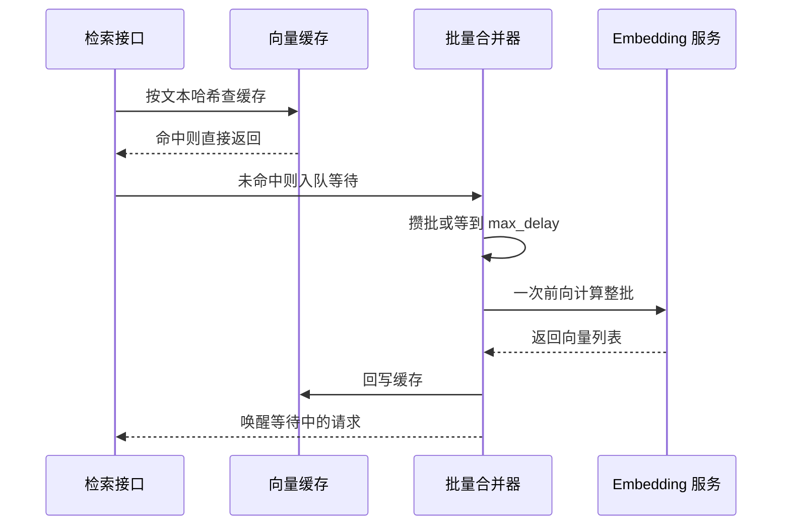

# 在线 embedding 成了写入与查询的公共瓶颈：micro-batch、缓存与降级的组合怎么落地

## 为什么会有这个问题

在 RAG 系统里 embedding 服务是查询链路和入库链路的共享依赖：用户 query 要实时转向量，文档导入也要批量转向量，两条链路争同一份推理配额。批量合并能抬高吞吐，但会把请求攒在队列里，直接抬高尾延迟，吞吐和 p99 天然对立。常见错误有四个：每个请求单独调一次 embedding，batch 恒为 1，加速卡利用率极低；不做任何缓存，热门 query 和重复文档反复计算；在 async 路由里直接调用同步 SDK，阻塞 event loop，让并发数上不去；对下游没有并发上限和超时，一旦排队就开始雪崩式超时。此外缓存一致性也要小心：文档更新后旧向量若未失效，会持续召回过期内容。

## 怎么做

1. 先量化现状：分开统计 query embedding 与文档 embedding 的 QPS、batch 分布、单次耗时、队列等待时间与加速卡利用率，判断是算力不够还是调用粒度太碎。
2. 在服务端做 micro-batching：设定 max_batch 与 max_delay 两个参数，收到第一个请求后最多等 max_delay 或凑满 max_batch 就发车，用线上 p99 预算减去下游耗时反推 max_delay，而不是凭感觉设 50ms。
3. 加两级缓存：query 向量按规范化后的文本哈希缓存（做大小写、空白、语言归一，多租户加 tenant 前缀），文档向量按 content hash 持久化，模型或维度变更时整体版本化失效，避免串用旧向量。
4. 把两条链路做隔离：导入任务走独立队列与独立配额、低优先级、可中断重跑；在线查询保留最小配额，防止一次全量重建把线上打挂。
5. 在 FastAPI 侧保证非阻塞：用 async client 或把同步调用放进线程池，设置明确的超时与取消，超时后降级到缓存或关键词召回而不是无限等待。
6. 补观测：embedding 服务 p99、平均 batch 大小、队列长度、缓存命中率、降级触发率、超时率，任一指标恶化都能定位到是批量策略还是容量问题。

## 关键代码

```python
import asyncio, hashlib

class BatchedEmbedder:
    def __init__(self, embed_fn, cache, max_batch=64, max_delay=0.01, workers=2):
        self.embed_fn, self.cache = embed_fn, cache
        self.max_batch, self.max_delay = max_batch, max_delay
        self.q, self.sem = asyncio.Queue(), asyncio.Semaphore(workers)

    async def embed(self, text):
        key = hashlib.sha256(text.encode()).hexdigest()
        if (hit := self.cache.get(key)) is not None:
            return hit
        fut = asyncio.get_running_loop().create_future()
        await self.q.put((text, key, fut))
        return await asyncio.wait_for(fut, timeout=2.0)

    async def run(self):
        loop = asyncio.get_running_loop()
        while True:
            batch = [await self.q.get()]
            deadline = loop.time() + self.max_delay
            while len(batch) < self.max_batch:
                left = deadline - loop.time()
                if left <= 0:
                    break
                try:
                    batch.append(await asyncio.wait_for(self.q.get(), left))
                except asyncio.TimeoutError:
                    break
            async with self.sem:
                try:
                    vecs = await self.embed_fn([t for t, _, _ in batch])
                    for (_, k, fut), v in zip(batch, vecs):
                        self.cache[k] = v
                        fut.set_result(v)
                except Exception as e:
                    for _, _, fut in batch:
                        if not fut.done():
                            fut.set_exception(e)
```

## 真实场景

某项目的知识库导入任务一启动，线上问答 p99 就从几百毫秒涨到数秒，超时率明显上升，而加速卡利用率却在 30% 与 100% 之间锯齿波动。排查发现三点：一是导入链路逐条调用 embedding，batch 恒为 1；二是在线查询与导入共用同一个 endpoint，没有配额隔离；三是 FastAPI 路由里直接调用了同步 SDK，event loop 被阻塞，并发上不去，只能靠客户端重试，重试又进一步放大队列。改造后：上线 micro-batching 把 batch 抬到几十，在线 query 向量加缓存，导入改走异步任务队列并限流到低优先级，同步调用挪进线程池并设置超时，超时直接降级为缓存命中或关键词召回。锯齿消失，导入期间线上 p99 恢复平稳。

## 示意图



## 面试官追问

1. **Q：** query 向量缓存值不值得做，边界在哪？

   **A：** 收益取决于 query 重复率与规范化质量。高频问法、多轮会话里的复述、以及多租户共用模板句式重复率高，收益明显；长尾自由文本为主、几乎没有重复的业务收益有限，还要承担一致性与内存成本。落地时要先统计文本归一化后的重复率，再决定缓存容量与 TTL，并保证模型或维度升级时整体失效。

2. **Q：** max_delay 调大吞吐更好但延迟更差，怎么定这个值？

   **A：** 用 p99 预算倒推：总预算减去检索、rerank、生成各段耗时，剩下的才是允许排队时间。再在压测里扫描几档 max_delay 与 max_batch，画吞吐-延迟曲线取拐点；线上按负载动态调整，高峰期把 max_delay 调小保尾延迟，低峰期放大提吞吐，同时监控平均 batch 大小作为策略是否生效的信号。


来源：https://github.com/didilili/ai-agents-from-zero/blob/main/19-RAG%E6%A3%80%E7%B4%A2%E5%A2%9E%E5%BC%BA%E7%94%9F%E6%88%90.md
