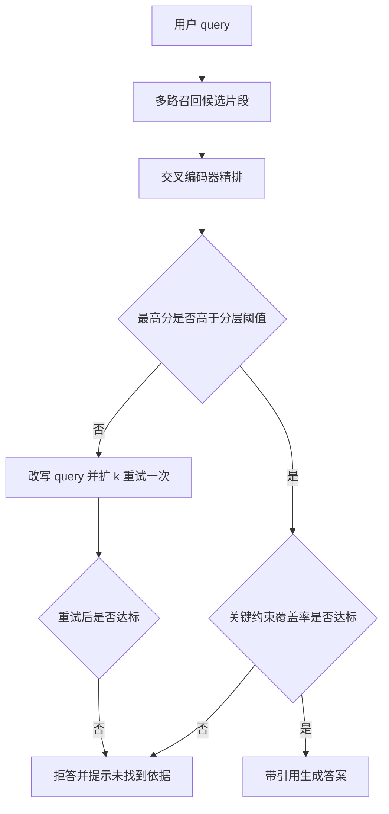

# 检索命中高相似度片段却答非所问：answerability 判定、拒答阈值与证据覆盖率怎么落地

## 为什么会有这个问题

余弦相似度衡量的是 query 与 chunk 在 embedding 空间里的接近程度，它既不代表片段里含有答案，也不能跨语料、跨模型比较。工程上常见的四类误判：一是 chunk 切分把答案切到了相邻块，命中的块只有铺垫；二是 query 短、doc 长，非对称语义下「话题相关」被算成高相似；三是问题含多个约束（时间、主体、口径），单个片段只覆盖一部分；四是换 embedding 模型或换语料后分数分布整体漂移，写死的 0.8 阈值直接失效。典型错误认知是把 top1 分数当置信度、把「模型回答流畅且带了引用」当作答对，结果是在没有证据时也强行生成，错误答案比检索不到更难被发现。

## 怎么做

1. 先分离两类失败：用带标注的评估集算 recall@k 与 MRR，判断是「gold 片段根本没召回」还是「召回了但没用上」，两者优化手段完全不同，不要一上来就调 prompt。
2. 用 cross-encoder 做精排，把判定阈值建在 rerank 分数上而不是 bi-encoder 余弦上；rerank 分数对「片段是否真的回答问题」判别力更强，且量纲相对稳定。
3. 阈值分层而非全局：按 query 类型（单跳事实、多跳比较、流程步骤）分别标定基线，用评估集上的分数分布取分位点，并定期用新采样重标。
4. 引入证据覆盖率：从 query 抽取关键实体与约束，检查 top-n 片段是否覆盖；覆盖率不足时不要直接作答，先做 query 改写或分解后重检索。
5. 设计降级路径：一次改写 + 扩 k 重试，仍不达标就拒答并给出「未找到依据」的明确回复，同时把该 query 落盘进未命中池，供后续补文档。
6. 把「引用段落命中率」「unanswerable 集合上的误答率」纳入线上看板，用抽样人工复核校准自动指标。

## 关键代码

```python
def gate(query, chunks, reranker, coverage_fn, cfg):
    scored = sorted(
        ((reranker.score(query, c.text), c) for c in chunks),
        key=lambda x: x[0], reverse=True,
    )[: cfg.top_n]
    if not scored:
        return {"action": "refuse", "reason": "empty_recall"}

    top_score = scored[0][0]
    cov = coverage_fn(query, [c for _, c in scored])
    base = cfg.thresholds.get(classify(query), cfg.thresholds["default"])

    if top_score < base or cov < cfg.min_coverage:
        return {
            "action": "retry_or_refuse",
            "top_score": top_score,
            "coverage": cov,
            "rewrite": True,
        }
    return {
        "action": "answer",
        "context": [c for _, c in scored],
        "top_score": top_score,
        "coverage": cov,
    }
```

## 真实场景

某项目上线知识库问答后，用户反馈「答得像模像样但引用的段落跟问题无关」。抽样回捞发现 top1 相似度普遍在 0.85 以上，pass 了原有 0.8 阈值，但引用段落命中率很低，且在被标注为「库里没有答案」的问题上几乎从不拒答。排查路径：先在评估集上算 recall@5，发现 gold 片段多数能召回，说明不是索引问题；再看精排后 top1 片段是否含答案，命中率低，确认是「相关但不可答」；同时核对分数分布，发现新语料接入后整体分数上移，旧阈值等价于失效。改造为 rerank 分数 + 分层阈值 + 覆盖率门控后，拒答率与误答率同时下降。

## 示意图



## 面试官追问

1. **Q：** 为什么不直接用余弦相似度设一个固定阈值做拒答？

   **A：** 分数分布依赖 embedding 模型、语料长度分布和 chunk 策略，任何一项变化都会整体平移；且不同 query 类型尺度不同。做法是分层标定 + 用 rerank 分数做主判据 + 覆盖率做辅助判据，并保留一个定期重标流程。

2. **Q：** 多跳问题在这种门控下会被误拒，怎么处理？

   **A：** 先做 query 分解，把子问题分别检索再融合去重，覆盖率按子问题维度分别计算而不是整体算；只有全部子问题都无证据时才拒答，部分缺失时在答案里显式标注哪部分无依据。


来源：https://github.com/didilili/ai-agents-from-zero/blob/main/18-%E5%90%91%E9%87%8F%E6%95%B0%E6%8D%AE%E5%BA%93%E4%B8%8EEmbedding%E5%AE%9E%E6%88%98.md
