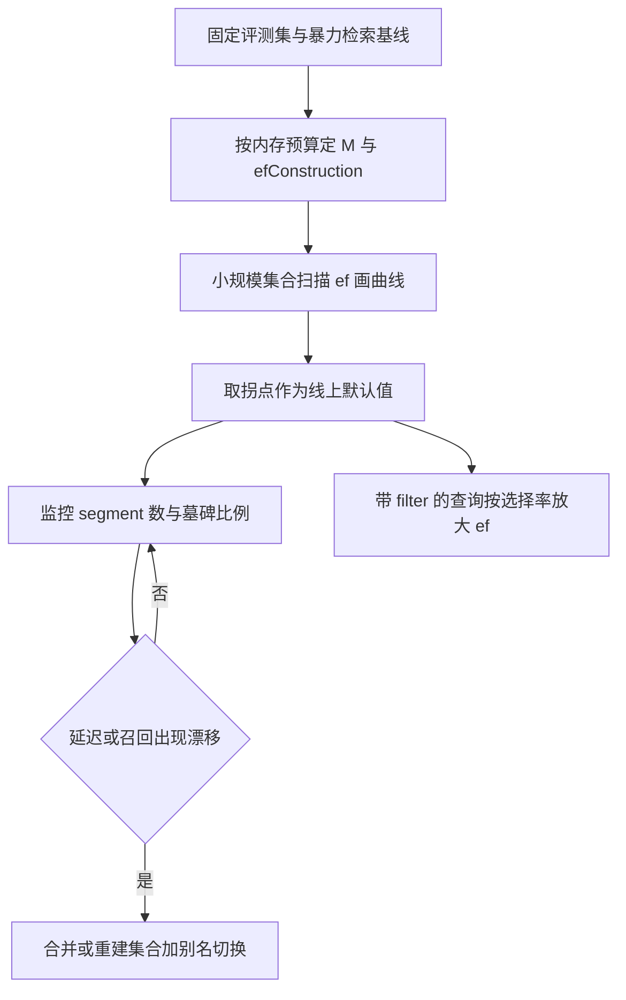

# HNSW 的 ef 调大后离线召回达标了，但线上 p99 翻几倍、跑两周还越来越慢：参数、内存与墓碑怎么一起算

## 为什么会有这个问题

HNSW 的参数被分成了两类，很多人把它们混为一谈：M 与 efConstruction 决定图本身的质量（每个节点的出度、建图时候选队列的长度），一旦建完就基本改不了；ef（查询期）只是把搜索前沿放宽，它只能在「已有的图」上延伸搜索，无法补回图里根本没连上的近邻。所以典型错误认知是「召回不够就把 ef 调大」，短期指标确实会涨，代价是每次查询要访问的候选点线性增加，QPS 和 p99 直接崩。第二个被忽视的点是更新：向量库普遍按 segment/段组织，upsert 与 delete 先写标记，旧点变成墓碑，在合并（compaction/optimize）之前查询仍要路过它们，于是出现「参数没变、数据没涨，但延迟和内存一路走高」。第三个坑是 filtered search：带 filter 时 ef 的候选池被过滤条件稀释，选择率低的条件实际有效候选远小于 ef，recall 会莫名下降，而纯向量基准测不出来。

## 怎么做

1. 先建立可复现的召回基线：固定评测集（query → 已知相关 doc id），用暴力检索或 exact search 的结果作为 ground truth，统一用 recall@k 口径，禁止用人工「看起来相关」判断。
2. 做内存预算建模：向量本体 n×dim×4 字节，加上图结构（底层约 2M 个邻居、上层约 M 个，每个 4 字节 id），再加上 payload 与原始文本；先给 M 定一个内存上限，再谈参数。
3. 在小规模集合（如全量 10% 采样）上固定 M/efConstruction，只扫描 ef，画 recall–QPS–p99 三条曲线，取曲线拐点作为 ef 默认值，而不是取 recall 最高的点。
4. 为带 filter 的查询单独校准：按过滤选择率放大 ef（如 ef_eff = min(ef_base / selectivity, cap)），或让存储层先做 payload 预过滤，再把结果喂给图搜索；两条路径都要有基准。
5. 把更新纳入运维：监控 segment 数量、被标记删除的点占比、单 segment 大小；设置合并/优化阈值，大批量变更走「新集合重建 + 别名原子切换」，而不是原地长期 upsert。
6. 上线后做在线抽样评测（按比例抽样并标注），同时看 p99、每查询访问点数、segment 数与内存；把召回衰退和延迟衰退分开归因，避免把墓碑问题误判成参数问题。

## 关键代码

```python
import time
import numpy as np

def recall_at_k(gt, got, k):
    return len(set(got[:k]) & set(gt[:k])) / k

def mem_bytes(n, dim, m, payload_bytes=200):
    vec = n * dim * 4
    graph = n * (2 * m * 4 + m * 4)          # 底层 2M 邻居 + 上层近似 M
    return vec + graph + n * payload_bytes

def sweep(client, coll, queries, gt, k=10, efs=(32, 64, 128, 256)):
    rows = []
    for ef in efs:
        hits, lat = [], []
        for q, g in zip(queries, gt):
            t0 = time.perf_counter()
            res = client.search(coll, q, limit=k, params={"ef": ef})
            lat.append(time.perf_counter() - t0)
            hits.append(recall_at_k(g, [r.id for r in res], k))
        rows.append({"ef": ef,
                     "recall": round(float(np.mean(hits)), 4),
                     "p99_ms": round(float(np.percentile(lat, 99)) * 1000, 1)})
    return rows
```

## 真实场景

某项目的离线基准显示 ef 从 64 提到 256 后 recall@10 明显上升，于是直接改了线上默认值。上线后 QPS 掉到原来的一小部分、p99 涨了数倍，而业务侧反馈「答案没变好」。更麻烦的是集合每天有大量 upsert，跑了两周后即使把 ef 调回原值，延迟仍高于初始水平。排查路径：先看集合的 segment 数量与被标记删除点占比，发现长期未合并、内存虚高；再抓一批真实请求，发现大部分查询带租户与时间过滤，选择率极低，ef 的候选池被过滤条件吃掉大半，实际有效搜索深度远小于配置值；最后用同一评测集在「只读快照」上复测，确认图质量受 M 约束，单纯抬 ef 的收益早已饱和。处理方式是：重建集合时提高 M 与 efConstruction，线上 ef 取拐点值，filter 查询按选择率放大 ef，并把合并策略与别名切换纳入例行运维。

## 示意图



## 面试官追问

1. **Q：** 为什么把 ef 一直调大不能解决召回问题？M 到底影响什么？

   **A：** ef 只扩大查询期要探索的候选队列，搜索仍然沿着图中已有的边前进；M 决定每个节点保留多少邻居，M 太小会导致本该近邻的点在图里压根没连上，这时再大的 ef 也走不到。efConstruction 影响建图时挑邻居的搜索深度，决定边的质量。三者职责不同：M/efConstruction 是建图期的质量上限，ef 是查询期的成本-召回旋钮，因此正确做法是先按内存预算定 M、用采样数据验证建图质量，再扫 ef 取拐点。

2. **Q：** IVF-PQ、DiskANN 这类方案在你的场景里什么时候反而更合适？

   **A：** 当内存是主要约束、数据量很大、可接受一定量化误差时，IVF-PQ 用聚类加乘积量化压缩向量，内存占用显著下降，nprobe 可以调节召回与延迟；但它需要训练码本，分布漂移要重训，且对高 recall 场景通常吃亏。DiskANN 把图放在 SSD 上、内存只放压缩向量与少量入口点，适合超大规模且能接受单次查询的磁盘 IO 延迟、更新不频繁的场景。选型看四个维度：内存预算、目标 recall 下限、更新频率、p99 容忍度，任何一项给不出来就不该拍板。


来源：https://github.com/guocong-bincai/ai-interview-guide/blob/main/docs/06-vector-index-optimization/README.md
