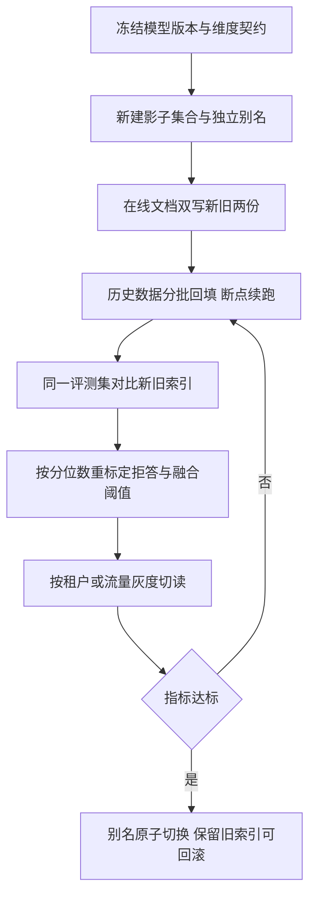

# 换了 embedding 模型后拒答阈值全部失效、新旧向量还混在一个集合里：影子索引、阈值重标定与灰度切换怎么做

## 为什么会有这个问题

换 embedding 模型不是「换个 encoder 重跑一遍」这么简单。第一，向量空间整体改变：不同模型的训练目标、语言分布、是否归一化、pooling 方式都不同，两个空间的余弦相似度数值不可比，跨空间算出来的距离在语义上没有意义——但只要维度相同，代码不会报错，于是静默污染，表现为「召回莫名其妙、有的文档永远召不回、有的永远排第一」。第二，所有依赖分数的下游全部失效：拒答阈值、rerank 前置过滤、混合检索的加权融合、缓存命中判定，都是按旧模型的分数量纲调出来的，直接沿用会造成大规模误拒或误放行。第三，全量重算是硬成本：docs×tokens 的编码开销、限流窗口、失败重试，还要保证回填期间线上照常可服务、可回滚，这本质是一次带状态的数据迁移。

## 怎么做

1. 冻结模型契约：把模型名、版本、维度、归一化方式写进集合元数据与别名命名，写入与查询两端都做校验，宁可启动失败也不要混写。
2. 新建影子集合：用新模型建独立 collection + 独立 alias，在线新文档双写两份；旧集合保持可读，作为回滚底座。
3. 历史数据分批回填：按 doc id 水位做断点续跑，同 id upsert 保证幂等，用并发与 QPS 上限保护在线读写，失败批次可重放而不重复计费。
4. 阈值重标定而非直接沿用：在同一评测集上分别跑旧/新索引，把分数按分位数对齐（如都取 top-1 分数的 p10/p50/p90 做映射），再重设拒答与融合阈值，禁止跨模型比绝对值。
5. 同集对比与灰度：用固定评测集比 recall@k、端到端答案正确率、拒答率、长尾与多语言 query 表现；达标后按租户或流量比例切读，双读对比但只返回主路结果。
6. 缓存与回滚：query embedding 缓存 key 带上模型版本，答案缓存带上索引别名版本；切换动作是别名原子切换，旧索引保留一个观察窗口，异常时一键切回。

## 关键代码

```python
import itertools
import time

def batched(it, n):
    it = iter(it)
    while chunk := list(itertools.islice(it, n)):
        yield chunk

def backfill(src, dst, model, ckpt, batch=128, qps=20):
    watermark = ckpt.load()                       # 已完成的 doc id 水位
    docs = (d for d in src.iter_docs(after=watermark) if d.id > watermark)
    for chunk in batched(docs, batch):
        texts = [d.text for d in chunk]           # 先物化，避免生成器被消费两次
        vecs = model.encode(texts, normalize=True)
        dst.upsert([{"id": d.id, "vector": v, "payload": d.payload,
                     "meta": {"model": model.name, "rev": model.rev}}
                    for d, v in zip(chunk, vecs)])   # 同 id 覆盖，天然幂等
        ckpt.save(chunk[-1].id)                   # 逐批推进水位
        time.sleep(len(chunk) / qps)              # 限流，别挤占在线写入
```

## 真实场景

某项目把 embedding 模型从旧版换到新版本，维度恰好一致，为了省事直接对原集合 upsert 覆盖。结果是：回填任务中途因限流超时中断，重跑时又从头扫，一半文档是新向量一半是旧向量；检索侧完全看不出异常，但部分老文档彻底召不回。同时拒答阈值沿用旧值，新模型分数整体偏低，大量本可回答的问题被判为不可答，用户侧表现为「知识库明明有却说不知道」。排查路径：先抽样比对集合内的 model 元数据分布，确认混写；再用同一评测集分别在纯旧向量与重新全量写入的新向量上跑 recall 与拒答率，发现阈值必须按分位数重标定；最后核对 query embedding 缓存未带版本，命中了旧模型的向量。收敛做法是重建影子集合、断点续跑回填、阈值按分位数重设、按租户灰度后再别名切换。

## 示意图



## 面试官追问

1. **Q：** 新旧模型维度相同，是否可以共用一个集合，靠 payload 里的 model 字段过滤来区分？

   **A：** 不建议。同一集合内的向量会被同一个图/聚类结构组织，两个空间的点混在一起会互相成为邻居，过滤只能保证返回结果的来源，不能保证搜索路径没被污染，距离本身仍然不可比；而且索引结构无法按 filter 分区训练。正确做法是集合或别名级隔离，模型版本写进集合元数据做写入校验，迁移用双写加别名切换完成。

2. **Q：** 怎么判定这次模型切换是成功的，而不只是「跑通了」？

   **A：** 三个层面同时看：检索层用固定评测集的 recall@k 与 MRR 对比新旧索引；答案层看端到端正确率、拒答率与拒答是否正确（该拒的拒、不该拒的别拒）；分布层看长尾 query、多语言、时间新近文档的表现，避免新版只在头部热门问题上变好。阈值必须先按分位数重标定再比较，否则分数尺度差异会伪装成效果差异；另外回填遗漏率（集合内 model 元数据分布）也要作为验收项。


来源：https://github.com/cdavid817/agent-interview/blob/main/docs/02-capabilities/rag/embedding-vector-1.md
