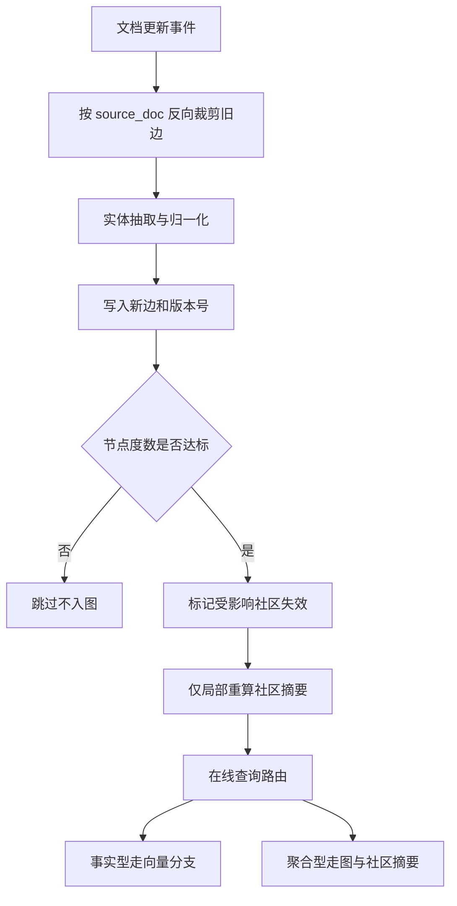

# 想用 GraphRAG 解决「跨文档多跳与汇总类」问题：抽取成本、实体归一化与增量社区重建怎么一起算

## 为什么会有这个问题

向量 RAG 的检索单元是 chunk，本质是「局部语义相似」；当问题需要跨多篇文档做聚合、对比、多跳推理（例如「哪些组件同时被 A 和 B 两个流程依赖」），单 chunk top-k 里根本不存在这样一条证据，召回再准也答不对。GraphRAG 的取舍是「用离线昂贵的抽取与社区摘要，换在线可聚合的图结构」，它不是「更准的向量检索」，而是一次预处理成本与查询能力的置换。常见错误认知有三个：（1）先上 GraphRAG 再想评测，结果事实型问题毫无提升却背了全量抽取成本；（2）实体不做归一化，同一实体在图中分裂成十几个节点，社区摘要被噪声淹没、边数爆炸；（3）把图当成 append-only，文档更新后只加边不删旧边，导致摘要里长期存在已删除的事实，且每次新增文档都触发全量社区重建。

## 怎么做

1. 先用评测集判定「是否真的需要图」：从真实日志里抽出 50–100 条聚合型/多跳型 query 单独成集，对比纯向量基线在这些 query 上的答案正确率；如果提升不明显，优先用 metadata 过滤 + 结构化关系表 + 少量 SQL 覆盖，成本低一到两个数量级。
2. 做成本建模：抽取阶段按「每千字文档消耗的 token」估算全量成本，社区摘要按层数近似超线性增长估算；把「全量重建一次」和「每月增量 N 篇」分别算出来，与业务对新鲜度的要求对齐，再决定语料范围（只对高价值语料建图）。
3. 实体归一化先行：维护别名表 + embedding 聚类召回候选 + 人工抽检 top 实体，产出稳定的 canonical_entity_id；抽取阶段就落归一化后的 id，而不是事后合并。设置度数下限，孤立/低度数节点不进图，避免社区碎片化。
4. 把图的写入设计成「以文档为中心可回滚」：每条边带 source_doc_id 与 doc_version，更新文档时先按 doc 反向裁剪旧边再加新边；社区摘要按节点局部失效（invalidate），只对受影响的社区重算，而不是整图重建。
5. 在线加 query 路由：用小分类器或规则把 query 分成事实型 / 聚合型；事实型走向量分支，聚合型走图 + 社区摘要，混合时把图结果当 evidence 注入并严格限制 token 预算，避免把整个社区摘要塞进 prompt。
6. 灰度与回归：按 query 类型分别看正确率与 p95 延迟，同时对「已删除文档的事实是否还被引用」做定期抽检。

## 关键代码

```python
def ingest_doc(doc, graph, extractor, community_index):
    for e in graph.edges_by_doc(doc.id):
        graph.remove_edge(e)
    triples = extractor(doc.text)
    touched = set()
    for s, r, o in triples:
        s_id, o_id = normalize(s), normalize(o)
        if s_id is None or o_id is None:
            continue
        graph.upsert_edge(s_id, r, o_id, source_doc=doc.id, version=doc.version)
        touched |= {s_id, o_id}
    for nid in touched:
        if graph.degree(nid) < MIN_DEGREE:
            continue
        community_index.invalidate_node(nid)
    return touched


def route(query):
    if AGG_PATTERN.search(query) and graph.available:
        return "graph"
    return "vector"
```

## 真实场景

某项目把十几万份工单与设计文档一次性跑 GraphRAG：抽取阶段消耗了大量模型调用才完成，图和社区摘要建好后上线。观察到的典型现象是：普通「XX 怎么配置」类问题答案与原来的向量 RAG 基本无差别，只有「哪些模块同时依赖这两个服务」「这个季度反复出现的问题集中在哪些组件」这类聚合型问题明显变好；同时新增文档后，每次重建社区摘要耗时很长，且摘要里偶尔还能看到已经下线文档里的旧事实。排查路径：第一步按 query 类型拆分日志，确认收益集中在少部分聚合型 query；第二步抽样失败案例，发现同一供应商/组件在图中分裂成多个节点（归一化缺失），摘要被重复实体稀释；第三步检查更新流程，发现文档更新走的是 append 而非「先删旧边」，且社区重建是全量触发。改进方向是缩小建图语料范围、补齐 canonical id、改成按文档反向裁剪 + 局部社区失效，并给在线加 query 路由。

## 示意图



## 面试官追问

1. **Q：** 如果业务方坚持「全部语料都要建图」，你怎么回应？

   **A：** 不直接否定，而是把成本与收益摊开：给出全量抽取的 token 成本、首次建图时长、增量重建频率对应的月度开销，以及按 query 类型的收益分布——通常 80% 以上流量是事实型，图的边际收益集中在少数聚合型 query 上。然后给折中方案：按业务价值给语料分级（高频引用文档先建图），或用更轻的抽取器（规则 + 词典辅助）先覆盖实体与关键关系，把 LLM 抽取留给核心语料。

2. **Q：** 实体归一化怎么做到可维护，而不是一次性人工对齐？

   **A：** 三层：别名表是事实来源（人工确认的高置信映射，带版本）；embedding 聚类只用来「发现候选」，相似度高于阈值的新实体进入待审队列而不是自动合并；线上加度量——统计同名不同 id、同 id 多名称的比例，以及合并后边的度数变化，异常上升就回滚。关键是合并操作要可逆，保留 merge 记录。


来源：https://github.com/guocong-bincai/ai-interview-guide/blob/main/docs/03-rag-system/README.md
