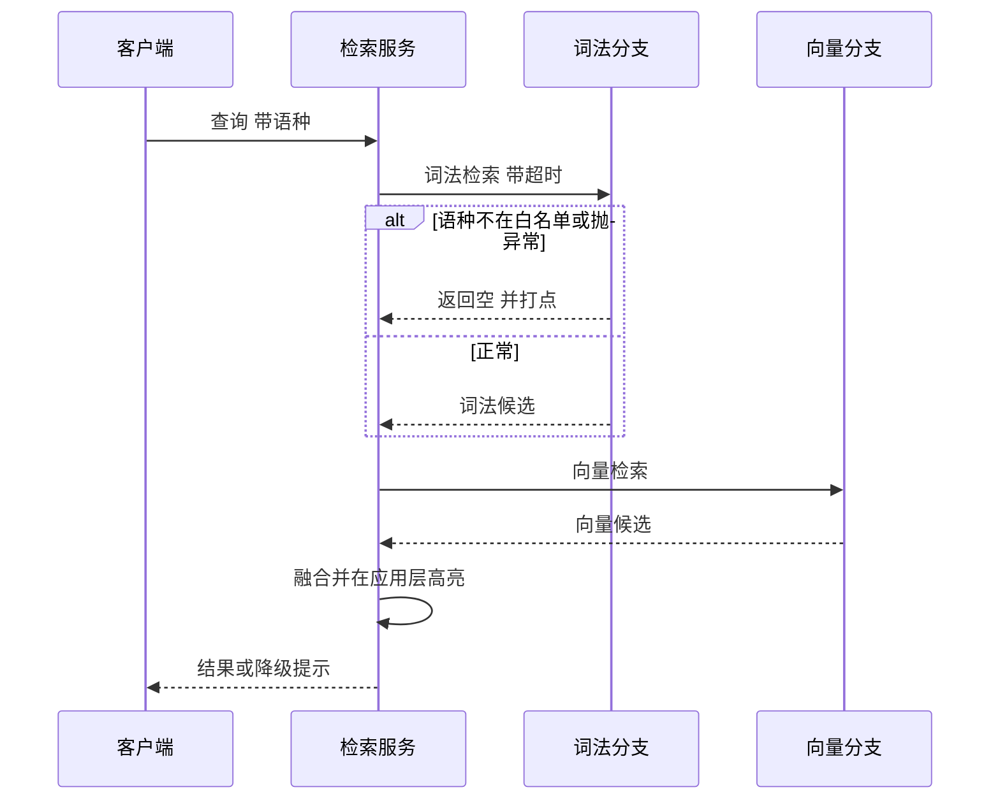

# 混合检索的关键字分支偶发 500、高亮字段为 null 就报错：词法索引的边界数据该怎么治理与降级

## 为什么会有这个问题

混合检索里大家把注意力放在向量侧，词法/全文分支常被当成「配一下就行」的基础设施，但它对输入数据的敏感度远高于向量：stemmer 按语种分词、payload 索引要求字段类型一致、highlight 依赖字段可被匹配到。一旦出现未验证的语种字符、带变音符的词形、nullable 字段里的 null，词法引擎可能在分词阶段抛异常直接返回 5xx，而不是「召回为空」。更糟的是这类错误是数据相关的长尾——同一批查询 99% 正常，某个语种或某几条文档一旦命中就稳定失败，客户端重试还会放大成雪崩。常见错误认知是「词法失败就当没召回」，但如果异常没被隔离在词法分支内，它会污染整个混合检索请求。

## 怎么做

1. 把词法分支做成「可失败且失败可观测」的独立单元：单独设超时（远小于整体预算）、捕获所有异常、失败时返回空列表并 fail-open 到纯向量分支；同时按语种/字符集/错误类型打点，避免错误被静默吞掉。
2. 建语种白名单：只对已验证过 stemmer 与分词的语种启用词法索引，新语种上线前用真实语料做回放（包含变音符号、大小写、混合语言、emoji、超长 token），验证通过再加入白名单；白名单之外的语种走向量分支或字符级 n-gram 匹配。
3. 写入侧做规范化与校验：null 统一归一化为空串（或直接不写该字段），避免 nullable 字段在 match/highlight 时字段缺失；对文本做 NFC 规范化、控制字符剥离、长度截断，并在入库前跑一个轻量 preflight，把异常样本挡在索引外而不是等查询时炸。
4. 高亮不要依赖引擎：在应用层用召回的原文做字符串匹配高亮，或对引擎返回的 highlight 做容错（字段缺失就回退到原文首段），避免「高亮失败导致整个响应构造失败」。
5. 做数据分桶监控：按语种、是否有 payload 词法索引、字段是否为空统计 5xx 率与空召回率；对「同一 query 稳定失败」做指纹聚合，便于快速定位是数据问题还是引擎版本问题，并在升级引擎版本时把已知边界样本纳入回归集。
6. 准备降级链：词法失败 → 纯向量；向量也失败 → 缓存/serve_stale 或明确返回降级提示；上游不要无脑重试 5xx，对可重试错误加 jitter 与上限。

## 关键代码

```python
LEXICON_LANGS = {"zh", "en"}


def lexical_search(q, lang, limit=20, budget=0.15):
    if lang not in LEXICON_LANGS:
        return []
    try:
        return call_with_timeout(
            lambda: client.search_text(q, lang=lang, limit=limit), budget)
    except Exception as e:
        metrics.incr("lexical_fail", tags={"lang": lang, "err": type(e).__name__})
        return []


def normalize_payload(payload):
    out = {}
    for k, v in payload.items():
        if v is None:
            continue
        out[k] = unicodedata.normalize("NFC", str(v))[:MAX_FIELD_LEN]
    return out


def hybrid_search(q, lang, vec):
    text_hits = lexical_search(q, lang)
    vector_hits = vector_search(vec, limit=20)
    return fuse(text_hits, vector_hits)
```

## 真实场景

某项目做多语种知识库的混合检索，上线后前端偶发「搜索整个不可用」：同一批查询大部分正常，但某些查询稳定 5xx。按语言分桶后发现集中在少数小语种词形上——词法索引在分词阶段直接抛异常，请求返回 500；客户端带重试，单个坏查询在高峰期被放大成一片 5xx。另一条线是「高亮失败」：文档里的可匹配字段为 null 时，highlight 找不到字段直接报错，导致本来已经召回成功的请求在构造响应阶段失败。排查路径：先按语言和字段空值率给 5xx 分组，确认与某个语种字符和 null 字段强相关；再用最小请求复现，确认异常发生在词法分支内部而非向量分支；最后检查客户端重试策略，发现 5xx 被无上限重试。修复是把词法分支隔离成可失败单元并 fail-open、语种白名单 + 入库前 preflight、null 归一化，高亮改到应用层做。

## 示意图



## 面试官追问

1. **Q：** fail-open 到纯向量分支，会不会让召回质量在不知不觉中下降？

   **A：** 会，所以降级必须可观测：词法失败不只是返回空，要打点并算「降级请求占比」与「降级请求的答案采纳率/无答案率」。设阈值告警，超过阈值就当作故障处理，而不是长期静默降级。同时把失败样本沉淀为回归集，在引擎升级或新语种接入前回放。

2. **Q：** 为什么不直接对所有语种关掉 stemmer，用字符 n-gram 更省事？

   **A：** 字符 n-gram 对中文、日文这类无空格语言其实不错，对英文会显著增加索引体积与误召回，而且丢掉词形归并后同义词召回变差。更务实的做法是分层：拉丁语种用验证过的 stemmer，CJK 用 n-gram 或分词器，未验证语种先退回字符级匹配并把词法权重调低，等语料回放通过再提权重。


来源：https://github.com/qdrant/qdrant/issues/11386
