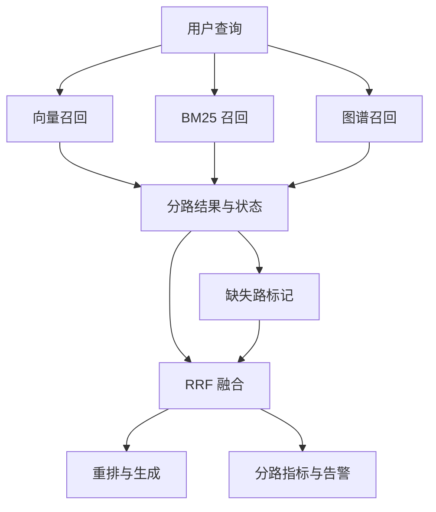

# 多路召回里某一路超时后 RRF 融合结果悄悄变差：分路预算、缺失标记与降级怎么落地

## 为什么会有这个问题

多路召回通常把向量、BM25、图谱等异构召回器并发执行，再用 RRF 按排名融合。RRF 只看名次，不关心某一路是否因为超时、限流或异常返回空列表，所以单路失败不会让接口报错，却会让融合后的候选集悄悄偏向剩余路径。常见错误是只监控总 p95 延迟和接口错误率，不记录 per-path 的召回数量、失败状态与耗时；空结果和失败结果被同等对待，长尾 query 的召回覆盖先下降，最终表现为答案变窄但无人告警。

## 怎么做

1. 给每条召回路定义独立超时预算和 SLO：从总检索预算反推，例如总 300ms，向量 120ms、BM25 80ms、图谱 60ms，融合与重排预留剩余时间；超时不是异常抛出，而是返回带 status 的结构化结果。
2. 融合层显式携带 degraded 标记：区分 ok、timeout、error、empty 四种状态；缺失路不参与 RRF 计分，记录 per-path hit rate、empty rate、p99 延迟和融合前后 top-k 重叠率。
3. RRF 实现保持简单：score = sum(weight / (k + rank))，对 chunk 按 doc_id + 内容指纹去重；每路设置 topN 配额，避免某一路召回数量过大主导融合；不要直接把不同召回器的原始分数加权平均。
4. 对高贡献路径设置熔断与 fallback：单路失败率连续超过阈值时告警并降级到缓存结果或单路检索；用故障注入回归测试验证单路超时后的答案质量下降在可接受范围内。
5. 按查询类型调整路径权重：精确术语查询提高 BM25 权重，语义问法提高向量权重，关系型问题提高图谱权重；权重来自离线评估，不在线用 LLM 动态调参。
6. 把路由与融合决策写入 trace：记录 query 类型、各路 topN、状态、耗时、融合后 top-k 变化，便于事后定位是召回缺失还是生成问题。

## 关键代码

```python
import asyncio, hashlib
from dataclasses import dataclass

@dataclass
class Hit:
    doc_id: str
    text: str
    rank: int = 0

async def run_path(name, fn, query, timeout, weight):
    try:
        items = await asyncio.wait_for(fn(query), timeout)
        return name, weight, items, 'ok', timeout
    except asyncio.TimeoutError:
        return name, weight, [], 'timeout', timeout

def rrf(path_results, k=60, limit=20):
    scores, store, degraded = {}, {}, []
    for name, weight, items, status, _ in path_results:
        if status != 'ok':
            degraded.append(name)
        for rank, hit in enumerate(items, 1):
            key = hashlib.md5((hit.doc_id + hit.text[:64]).encode()).hexdigest()
            store[key] = hit
            scores[key] = scores.get(key, 0.0) + weight / (k + rank)
    ranked = sorted(scores.items(), key=lambda x: -x[1])[:limit]
    return [store[key] for key, _ in ranked], degraded

async def search(query, paths):
    results = await asyncio.gather(*[
        run_path(name, fn, query, timeout, weight)
        for name, fn, timeout, weight in paths
    ])
    hits, degraded = rrf(results)
    return {'hits': hits, 'degraded': degraded}
```

## 真实场景

某项目的 RAG 检索由向量、BM25、图谱三路并发组成，平时总 p95 在预算内。某段时间夜间索引重建，BM25 路偶发超时，接口仍返回 200，总延迟看起来正常，但客服反馈长尾问题答案变窄。排查 trace 发现 lexical 路 hits=0 且没有失败标记，RRF 融合后 top-10 几乎全由向量路贡献，融合前后重叠率异常升高。进一步做单路故障注入，复现了召回覆盖下降。修复后为每路增加超时预算和 status 字段，融合层输出 degraded 列表，并对 BM25 失败率设置告警和缓存 fallback。

## 示意图



## 面试官追问

1. **Q：** RRF 和加权分数融合应该怎么选？

   **A：** 异构召回器的分数量纲和分布通常不可比，RRF 只用排名，冷启动和线上漂移更稳；加权分数融合需要归一化或学习校准，维护成本高。可以先用 RRF 融合，再用轻量 rerank 统一打分。

2. **Q：** 单路超时阈值怎么定才合理？

   **A：** 从总检索预算反推，结合每路 p99 延迟和对最终答案的离线贡献度分配；高贡献路给更大预算并设置熔断，低贡献路可快速失败。用故障注入验证不同超时下的召回和答案质量。


来源：https://github.com/guocong-bincai/ai-interview-guide/blob/main/docs/03-rag-system/README.md
