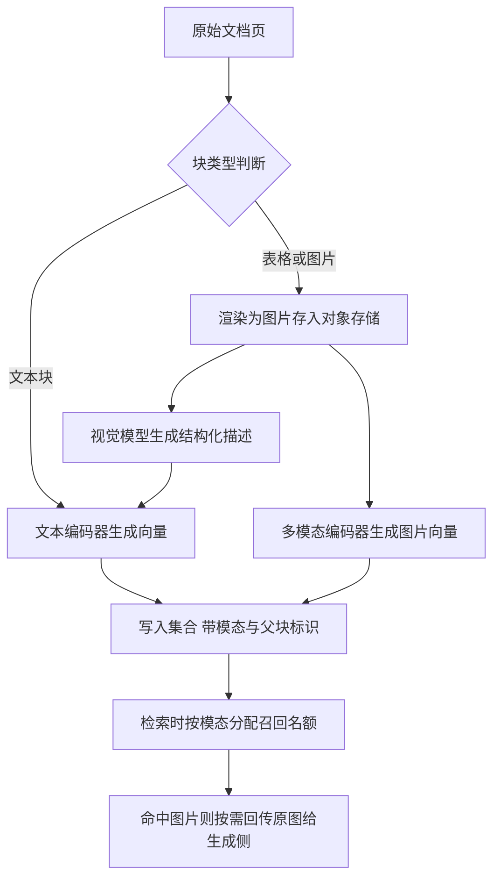

# PDF 里的图表和扫描页接进 RAG 后，文本题反而被答错：多模态 Embedding、图片转描述与重嵌入成本怎么取舍

## 为什么会有这个问题

线上知识库很少是干净的纯文本：PDF、扫描件、PPT 里大量关键信息在表格、架构图、截图里。纯文本抽取会丢（表格被打散成乱序 token，图片直接丢弃），团队于是想一步到位，把每页渲染成图片、用多模态模型编码后塞进同一个 collection。常见认知错误是「同一维度就能比较」：如果文本块用文本编码器、图片块用另一个多模态编码器，即便维度相同，向量分布也不在同一空间，跨模态相似度没有可比性，阈值和 top-k 全失效；更隐蔽的后果是图片块在高相似区间挤占名额，原本能答对的文本题反而答错。另一条错误路线是只做 OCR 转文本，图表语义丢了，检索命中了也答不出。此外图片的分辨率决定视觉 token 与重嵌入耗时，全量重渲染会把更新链路拖慢一个量级。

## 怎么做

1. 先按文档类型和真实 query 意图分层：统计哪些问题必须靠视觉证据（图表数值、版式、示意图），哪些用文本足够；只对前者投入视觉链路，避免全量上图片。
2. 两条路线并列评估并量化：路线 A 用同一多模态编码器对文本块与图片块编码（同空间可比）；路线 B 用视觉模型把图表转成结构化描述（表格转 markdown、图转要点），与图注、邻近正文一起编码。对比维度固定为：图表类问题的 recall、单文档 ingestion 成本、重嵌入耗时、生成侧视觉 token 成本、可解释性。
3. 推荐混合落地：图片走多模态向量召回候选，命中后再把原图（按需裁剪、降分辨率）送生成模型；低风险类别（如流程图类问答）用路线 B 的文本描述兜底。
4. 分块上采用父子结构：图片与其 caption、上下文段落绑定为一个父块，图片向量作为子块，检索命中子块后返回父块全文给生成侧，保证上下文完整。
5. 存储分层：图片二进制放对象存储，向量库 payload 只放 uri、模态标识、父块 id 与页码，不要把 base64 塞进 payload，否则集合膨胀且影响快照与备份。
6. 检索端加模态配额（quota）：文本与图片分别检索后再合并，限制图片块最多占 top-k 的一定比例，避免单一模态淹没结果。
7. 重嵌入与切换：新模态单独建 collection 并影子双跑，用同一套评测集对比「原文本链路」与「新链路」在文本题上的 recall 不掉、图表题 recall 提升，达标再切流量。
8. 把 ingestion 做成可增量：只对变更页重渲染，记录每页的渲染参数（dpi、裁剪框）作为版本，避免改一次模型就全量重跑。

## 关键代码

```python
def ingest_page(page, doc_id):
    rows = []
    for blk in page.blocks:
        parent = f"{doc_id}#{blk.parent_idx}"
        if blk.type == "text":
            for ch in split(blk.text, size=400, overlap=60):
                rows.append({"kind": "text", "parent": parent,
                             "text": ch, "vec": mm_embed_text(ch)})
        else:
            uri = blob.put(render_png(blk, dpi=150))
            desc = vlm_describe(uri) if blk.type == "table" else blk.caption
            rows.append({"kind": "image", "parent": parent, "uri": uri,
                         "text": desc, "vec": mm_embed_image(uri)})
    return rows

def search(q, k=8, image_quota=0.4):
    v = mm_embed_text(q)
    text_hits = store.search(v, k, flt={"kind": "text"})
    image_hits = store.search(v, k, flt={"kind": "image"})
    n_img = min(len(image_hits), int(k * image_quota))
    return text_hits[: k - n_img] + image_hits[:n_img]
```

## 真实场景

某项目的产品文档库里约三成页面含表格或架构图，用户高频问「这张表里 A 和 B 的参数差异」「这个流程图里失败分支走哪」。纯文本链路对这类问题经常答成泛泛描述。团队随后把每页渲染成 PNG、用多模态模型编码，与文本块混写同一 collection。上线后典型现象是：图表类问题略有好转，但原先答得对的纯文本题开始答错，且 top-k 里大量是整页图片块；同时每次文档更新都要全量重渲染重编码，更新延迟从小时级变成隔天。排查路径：把评测集按「文本题 / 图表题」拆成两条曲线分别看 recall，再看 top-k 结果里的模态分布与相似度分布，会发现图片块在中间相似度区间堆积，把文本块挤出名额；同时比对文本块与图片块所用编码器是否同一个，确认向量是否同空间可比。

## 示意图



## 面试官追问

1. **Q：** 多模态 Embedding 和「图片转文本描述」两条路，你怎么量化选型？

   **A：** 用同一套按题型分层的评测集对比：图表数值类、版式理解类、普通文本类分别看 recall 与最终答案正确率；再叠加成本项——图片编码的算力、存储体积、重嵌入耗时，以及生成侧是否必须回传原图（视觉 token 成本）。结论通常不是二选一，而是图片向量负责召回、文本描述负责兜底与可解释，按题型路由。

2. **Q：** 同一 collection 混模态，怎么防止一类挤占另一类的 top-k？

   **A：** 不要让不同模态直接混排：检索时按模态分别查询再做配额合并，或使用 named vector 分字段检索；此外为每个模态单独标定阈值，因为两个编码器（或同编码器不同模态）的相似度分布尺度不同，共用一个阈值必然出现一侧过召回一侧欠召回。


来源：https://github.com/guocong-bincai/ai-interview-guide/blob/main/docs/20-rag-advanced-optimization/README.md
