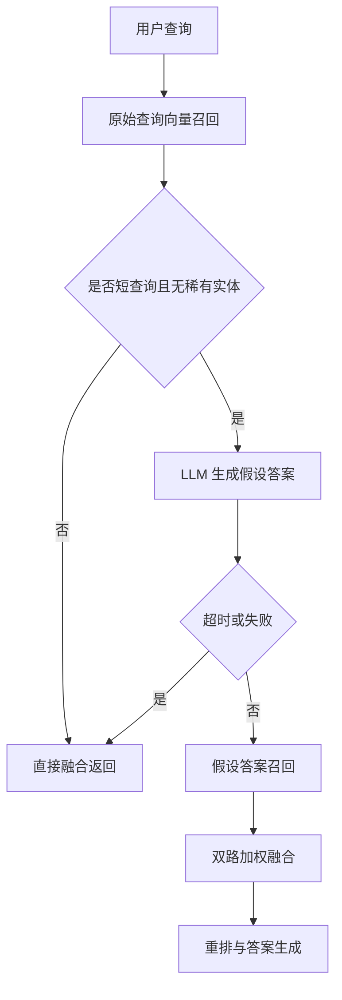

# 离线用大模型生成假设答案来提升召回，上线后延迟和幻觉反而增加：HyDE 的适用边界与降级怎么定

## 为什么会有这个问题

用户提问往往很短、口语化，且与知识库文档的写作风格（术语密集、陈述句）之间存在表达鸿沟，导致 query embedding 落在与文档向量不同的区域，出现「答案就在库里但召不回」。HyDE 的思路是先让 LLM 生成一段假设性答案，再用这段「伪文档」去检索，把查询侧向量拉近文档侧分布。常见错误认知有两个：一是把 HyDE 当成万能提效手段，忽略它引入了额外的 LLM 调用（首 token + 生成完整段落）、把生成模型的幻觉带进检索、以及在事实型精确查询（编号、错误码、人名）上会稀释关键词信号；二是只在离线评估集上调，忽略线上高并发下的 p99 抖动与成本。

## 怎么做

1. 先判定是否真的需要：把线上 badcase 按「query 与命中片段的向量距离分位」和「关键词匹配情况」分桶，只有当短查询（如少于 8 个 token）、无稀有实体、召回为空或 top1 分数低于阈值时才触发 HyDE，其余走原始 query，避免全量加一次 LLM 调用。
2. 实现上生成 1 段、长度受限（如 80–150 字）的假设答案，并显式约束「不要编造具体数字、专有名词」；同时保留原始 query 向量，做双路召回后融合，而不是用假设答案直接替换 query。
3. 对含数字、错误码、型号的 query 做实体检测，命中则跳过 HyDE 或强制开启 BM25 混合召回，防止假设答案里的错误实体把正确文档挤出候选集。
4. 设置超时与降级：HyDE 调用设 300–600ms 超时，超时或失败立即回退到原始 query 检索；把 HyDE 结果按 query 归一化做短 TTL 缓存（如几分钟），消化重复提问。
5. 用 A/B 或影子流量对比四组指标：Recall@k、首答正确率、p95/p99 延迟、每次查询成本；只有在 Recall 提升能转化为答案正确率提升时才保留，而不是只看召回。
6. 把假设答案写入 trace，便于事后归因：区分「HyDE 引入错误实体导致的错答」和「原本就召不回」两类问题。

## 关键代码

```python
async def retrieve(q: str, kb: str):
    base = await vector_search(q, kb, top_k=20)
    if not need_hyde(q, base):
        return fuse(base)
    try:
        hypo = await llm.agenerate(HYDE_PROMPT.format(q=q), max_tokens=160, timeout=0.6)
    except (asyncio.TimeoutError, LLMError):
        return fuse(base)
    hypo_hits = await vector_search(hypo, kb, top_k=20)
    return fuse(base, hypo_hits, weights=(0.4, 0.6))

def need_hyde(q: str, base) -> bool:
    if has_rare_entity(q):        # 错误码、型号、数字
        return False
    if len(tokenize(q)) > 12:
        return False
    return not base or base[0].score < SCORE_GATE
```

## 真实场景

某项目在问答助手里加了 HyDE 之后，离线评估集 Recall@10 有提升，但上线两周出现两种症状：一是 p99 从可接受范围明显上抬，高峰期排队；二是「查错误码 / 查型号」类问题开始答错，人工抽检发现召回的片段语义相近但版本不对。排查路径：按 query 类型分组看召回率，发现事实型短查询组下降、长口语问句组上升；再看 trace 里的假设答案，发现 LLM 在假设答案里自行「补全」了一个不存在的版本号，把向量拉向了另一个版本文档。最终改成按 query 特征路由 + 双路融合 + 实体检测跳过，并把超时降级补上。

## 示意图



## 面试官追问

1. **Q：** HyDE 和 query rewriting / query expansion 有什么区别，什么时候选哪个？

   **A：** query rewriting 是把用户口语改写成检索友好的表达，保留原始语义意图，成本低、可控性强；query expansion 是补同义词或上位词，提升召回宽度但容易引入噪声；HyDE 是生成「答案形态」的伪文档去对齐文档侧向量分布，对「短问题 vs 长文档」的表达鸿沟最有效，但引入生成幻觉和更高延迟。经验判据：查询歧义大、需要澄清意图 → rewriting；术语不一致、同义表达多 → expansion；查询极短且知识库文档是长篇陈述体 → HyDE。三者可以叠加，但要分别量收益。

2. **Q：** 怎么证明 HyDE 带来的召回提升是真实的，而不是评估集偏差？

   **A：** 第一，评估集要按线上 query 分布采样，包含空召回和事实型查询，不能只用「能答出来」的样本；第二，看 Recall@k 的同时看答案正确率和引用命中率，因为召回提升可能是召回了更多语义相近但事实错误的片段；第三，做分组分析（短查询/长查询/含实体/不含实体），确认收益集中在预期分组；第四，用影子流量跑线上真实分布，比较端到端指标而不是只看离线。


来源：https://github.com/guocong-bincai/ai-interview-guide/blob/main/docs/20-rag-advanced-optimization/README.md
