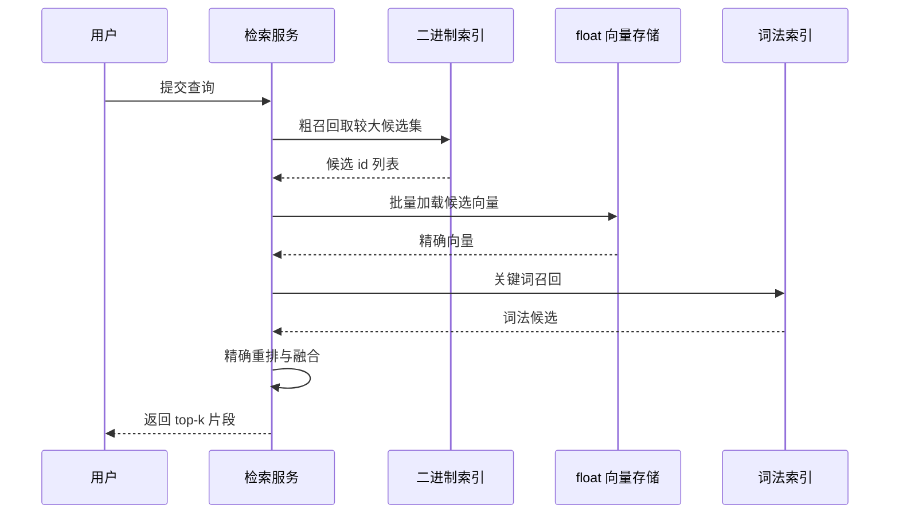

# 用二进制量化把索引内存压下去后长尾 query 答不出来：量化的召回损失怎么定位、怎么补

## 为什么会有这个问题

把 float32 向量换成 binary 或 PQ 编码，本质是用更少的比特保留方向信息。二进制量化只保留每一维的符号位，等价于在超球面上做极粗的角度划分，向量间的细微差异被抹平：当多个候选片段的相似度非常接近时（长尾、细节型、近义文档多的场景），排序被打乱，top-k 里就混进了错的片段。常见错误认知是「量化只影响精度不影响召回，调大 top-k 补回来就行」——实际补 top-k 会同时放大候选集与重排成本，而且当哈希碰撞严重时，正确答案根本没进候选池，加大 k 也捞不回来，还会拖高延迟。另一个误区是忽略不同 embedding 模型对量化的友好度差异：分布各向异性强、维度低、或者模型本身未做归一化的向量，量化损失会显著更大。

## 怎么做

1. 先量化损失，而不是先调参：用同一批真实 query，在原始 float 索引与量化索引上分别取 top-100，计算 Recall@k 的差值，并按 query 分桶（高频/长尾、单跳/多跳、含实体/纯语义），定位损失集中在哪一类。
2. 分离两类误差：一是「候选池未命中」（正确答案不在量化索引的 top-N 中），二是「排序错乱」（在池中但被挤出 top-k）。前者必须靠扩大候选或混合召回，后者可以靠重排修复。
3. 落地 rescoring 两段式：量化索引只负责粗召回（取较大的 N，如 100–200），再用原始 float 向量或交叉编码器对候选重排到 top-k；float 向量可放内存或磁盘，只对候选集加载。
4. 对二进制量化叠加混合召回：语义分支走量化向量，词法分支走 BM25/全文索引，用 RRF 融合，弥补符号位抹平导致的近义文档混淆。
5. 做参数与模型侧的取舍：优先选支持归一化的 embedding（余弦相似度下二进制量化更稳），必要时提升维度或用 int8 标量量化替代二进制；对比不同量化粒度的召回-内存曲线，而不是只看内存。
6. 上线做灰度与监控：监控 recall 相关的线上代理指标（引用命中率、拒答率、用户追问率），一旦长尾 query 组指标下滑就回滚或切到混合模式。

## 关键代码

```python
def search_two_stage(q: str, coarse_n: int = 150, top_k: int = 8):
    qv = embed(q)
    qb = binarize(qv)
    cand = index_binary.search(qb, top_n=coarse_n)
    ids = [c.id for c in cand]
    exact = load_float_vectors(ids)
    ranked = sorted(
        zip(ids, exact),
        key=lambda x: cosine(qv, x[1]),
        reverse=True,
    )[:top_k]
    lexical = bm25.search(q, top_k=top_k)
    return rrf_fuse([i for i, _ in ranked], [d.id for d in lexical])
```

## 真实场景

某项目为压内存把百万级向量集合改成二进制量化，内存占用明显下降、写入也变快，但上线后出现一类稳定复现的 badcase：用户问的是文档里某条细则的具体适用条件，库里存在多个高度相似的条款片段，回答开始张冠李戴，引用到相邻条款。排查路径：用线上真实 query 重放，对比量化前后 top-100 的候选集合，发现正确答案在量化索引里排到了 100 名开外，属于「候选池未命中」而非排序问题；同时该组 query 的向量相似度分布非常密集，符号位区分不开。最终改为量化粗召回 + float 重排 + BM25 融合，并把 coarse_n 按长尾组单独调大。

## 示意图



## 面试官追问

1. **Q：** 二进制量化和 PQ 在召回损失上的差异来自哪里，怎么选？

   **A：** 二进制量化每维只存 1 bit 符号，压缩率最高、距离计算可用位运算，但只保留方向的正负，区分度极低，适合高维、归一化良好、候选充足且能重排的场景。PQ 把向量切段后用码本聚类中心近似，保留更多信息，同等压缩率下召回通常更好，代价是需要训练码本、查询时要做查表累加，且对数据分布漂移敏感（码本需重训）。选型判据：内存压力极端且能接受两段式重排 → 二进制；需要在中等压缩率下保持较高召回、数据分布稳定 → PQ 或 PQ 的改进变体；对精度要求高且内存尚可 → int8 标量量化往往是性价比最高的折中。

2. **Q：** 如果 float 向量放在磁盘上做重排，延迟怎么控？

   **A：** 关键是限制重排规模并做局部性优化：coarse_n 要按延迟预算反推，而不是无脑加大；float 向量按 id 连续存放或按簇聚集，减少随机 IO；候选加载做并发批量读，避免逐条往返；对高频 query 的候选结果做短 TTL 缓存；必要时把热数据的 float 向量放内存、冷数据落盘，形成分层。上线前要用 p99 而不是均值来定 coarse_n。


来源：https://github.com/guocong-bincai/ai-interview-guide/blob/main/docs/06-vector-index-optimization/README.md
