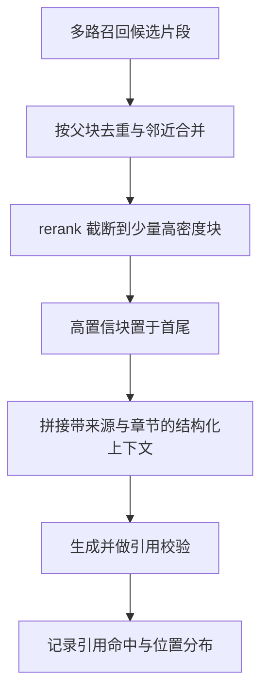

# 同一批召回片段换一下顺序答案就变了：上下文排布、位置偏置与块压缩怎么治理

## 为什么会有这个问题

LLM 对长上下文的利用并不均匀，放在中间的片段被引用的概率明显低于首尾两段；而绝大多数 RAG 链路只是按相似度降序把 top-k 直接拼接，把最关键的证据放在中段；如果 k 偏大，噪声块还会稀释注意力。常见错误认知是「答案不好就加大 k、把上下文塞满」，实际效果往往相反：token 成本上升，中间位置的信息密度更低，模型更容易只依据首段作答，引用也常落在第一个块上。另一个隐性问题是切块把步骤、表格和跨段指代切断，模型只看到局部片段，无法还原完整语义。

## 怎么做

1. 先做归因，不要急着改 prompt：固定同一批候选片段和同一批 query，只改变排列方式（相似度顺序、逆序、随机、把人工标注的金标块放在开头或结尾），观察答案正确率和引用命中率是否随位置波动。如果金标块换位置后答案就变，说明是位置利用问题；如果金标块无论放哪都答错，说明是切块质量或模型能力问题。
2. 减少片段数量、提升密度：先按父块去重并合并相邻块，把 k 收到较小值（经验上 5 到 8 块），再用 rerank 截断；对超长块做抽取式压缩，只保留与 query 相关的句子，同时保留标题路径和行号。
3. 调整位置策略：把 rerank 分数最高、与问题直接对应的证据放在开头和结尾，其余块按主题聚类后排列；多跳或汇总类问题不要一次性平铺，改成先分段提取再汇总的两阶段生成。
4. 结构化上下文：每块都带 source_id、文档标题、章节路径和序号，块之间用明确分隔符隔开，并在 prompt 中要求逐条引用；生成后做引用校验，检查每条结论是否落在给出的块内。
5. 建立回归指标：除答案正确率外，加入引用支持度、证据覆盖率、上下文 token 数和「引用落在第几块」的分布；上线时做 A/B 对比，避免只看个别 case 的观感。
6. 守住成本边界：把上下文预算设成硬上限，超出时按重要性裁剪，而不是无限增加 k；对高频 query 缓存编排结果。

## 关键代码

```python
def dedup_by_parent(chunks):
    seen, out = set(), []
    for c in sorted(chunks, key=lambda x: -x['score']):
        key = (c['doc_id'], c['parent_id'])
        if key in seen:
            continue
        seen.add(key)
        out.append(c)
    return out

def arrange(chunks, k=6, mode='sandwich'):
    picked = dedup_by_parent(chunks)[:k]
    if mode == 'sim':
        return picked
    half = max(1, len(picked) // 2)
    front, back = picked[:half], picked[half:]
    return front + list(reversed(back))

def position_sensitivity(run_qa, queries, pool, modes=('sim', 'reverse', 'sandwich')):
    report = {}
    for mode in modes:
        hits = []
        for q in queries:
            ctx = arrange(pool[q['id']], mode=mode)
            ans = run_qa(q['text'], ctx)
            hits.append(1.0 if q['gold_id'] in ans.citations else 0.0)
        report[mode] = round(sum(hits) / len(hits), 4)
    return report
```

## 真实场景

某项目做产品手册与 FAQ 的问答，最初把 top-20 全部拼进上下文，回答经常只引用第 1 条，问到手册中段的参数时开始编造或答成相邻型号；把 k 降到 6 并做父块合并后仍有波动。用位置实验复现：同一个金标片段放在第 1 位时答对，放在第 10 位时答错，说明检索本身没问题，是上下文利用问题。随后改成 rerank 截断、加压缩、高置信块前置和尾置，并加引用校验，引用正确率稳定下来，上下文 token 也明显下降；排查路径是「位置实验归因、切块与压缩、编排策略、引用校验指标」。

## 示意图



## 面试官追问

1. **Q：** 为什么不直接把 k 调大，让模型自己找？

   **A：** k 变大会同时引入噪声和中间位置信息，注意力被稀释，成本线性上升，而且真正关键的片段被稀释在中间后更容易被忽略。正确方向是提高单块信息密度，而不是堆数量：父块合并、抽取式压缩、rerank 截断、把必要证据放到首尾。只有在问题本身需要跨多段汇总时，才用分段提取再汇总的方式扩展上下文。

2. **Q：** 怎么区分是「位置问题」还是「召回/切块问题」？

   **A：** 做 oracle 注入：把人工标注的正确片段（或原文中对应段落）按不同位置注入上下文。如果注入后放首尾能答对、放中间答错，就是位置利用问题；如果放哪都答错，就是切块断裂、片段本身信息不足或模型能力问题。再用父块扩展和重新切块验证一次，即可定位。


来源：https://github.com/guocong-bincai/ai-interview-guide/blob/main/docs/20-rag-advanced-optimization/README.md
