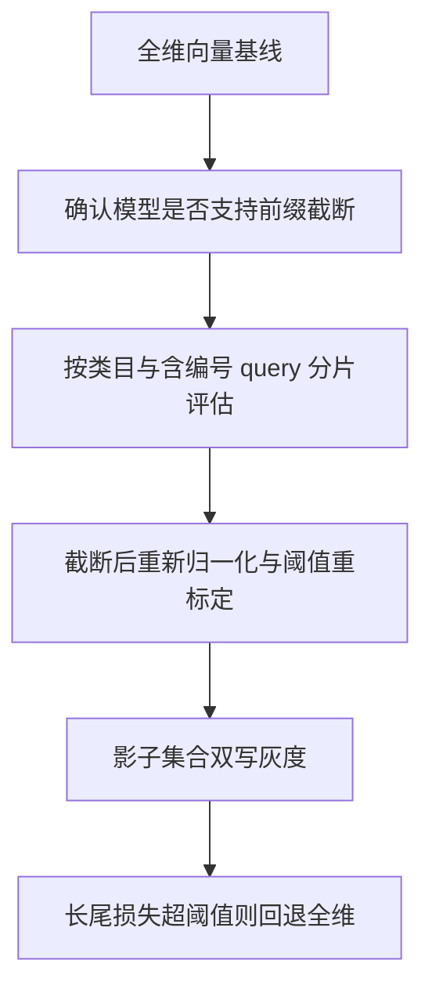

# 把 1536 维向量截到 512 维省存储，长尾类目召回崩了：降维的评估、重标定与回退怎么做

## 为什么会有这个问题

向量维度直接决定存储、内存和查询开销，截断维度看起来是最省事的降本手段，但这里有两个前提容易被忽略：只有经过 Matryoshka 式训练的模型，其向量前缀才近似可截断；普通模型直接切片，相当于把语义信息丢掉，而且不同维度上的能量分布被破坏。另一个常见错误是只看整体 recall@k：整体指标被高频简单 query 拉平，掩盖了长尾类目、含型号编号、专有名词这类 query 的下降。截断之后，向量模长和相似度分布都会变化，沿用原来的相似度阈值或拒答阈值，会出现漏召回或误召回；如果同时还叠了量化，误差叠加后更难定位。

## 怎么做

1. 先确认模型是否支持前缀截断（MRL 训练），不支持就只能换低维模型或评估降维方法；不要直接对任意模型切片后上线。
2. 建立分片评估集：按类目、query 长度、语言、是否含型号或编号、是否为长尾切片分别统计 recall@k 与 MRR，对比全维与截断维；同时构造高相似干扰项，观察区分能力。
3. 截断后重新处理：重新做 L2 归一化；用分位数法而不是固定值重标定相似度阈值和拒答阈值；如果需要量化，先截断再量化，并单独评估组合后的损失。
4. 归因排查时用 flat 暴力检索做基线，排除 ANN 参数造成的近似误差；再用相同索引参数分别建两套集合对比，确认是维度还是索引问题。
5. 灰度与回退：建立低维影子集合，双写一段时间，按流量比例对比引用正确率、拒答率和长尾切片表现；低维只做粗召回，用全维向量对 top-N 重排，兼顾成本和精度。
6. 成本核算要完整：算清存储、内存、构建时间、查询 QPS 的实际收益，与长尾损失对照；必要时按类目分层，高频类目走低维，长尾走全维集合路由。
7. 准备回退开关：低维集合只是索引层，原文与全维向量保留在对象存储或关系库中，确保能在一个构建周期内重建并切回。

## 关键代码

```python
import numpy as np

def truncate(vec, dim):
    v = np.asarray(vec, dtype='float32')[:dim]
    n = np.linalg.norm(v)
    return v / n if n else v

def slice_recall(queries, gold, k=10, dims=(1536, 512, 256)):
    out = {}
    for d in dims:
        per_slice = {}
        for q in queries:
            qv = truncate(q['emb'], d)
            scored = sorted(
                ((float(truncate(c['emb'], d) @ qv), c['id']) for c in q['cands']),
                reverse=True,
            )
            hit = 1.0 if gold[q['id']] in [i for _, i in scored[:k]] else 0.0
            per_slice.setdefault(q['slice'], []).append(hit)
        out[d] = {s: round(sum(v) / len(v), 4) for s, v in per_slice.items()}
    return out
```

## 真实场景

某项目知识库向量占用内存压力大，把 1536 维截到 512 维以降低存储和查询开销，离线整体 recall@10 看起来变化不大就上线了。上线后用户反馈「搜不到具体型号」的工单增加，典型现象是：通用问题命中正常，含型号、参数编号和长尾类目的 query 命中明显变差，拒答率也异常升高。排查路径是：先按切片拆指标发现长尾类目下降，再用 flat 暴力检索确认不是 HNSW 参数问题，最后定位到截断后未重新归一化、阈值沿用旧值，且模型前缀可截断性在长尾语义上损失较大；回退到全维做重排、并只对高频类目使用低维集合后恢复。

## 示意图



## 面试官追问

1. **Q：** 降维和量化应该先做哪个？

   **A：** 通常先降维再量化，两者误差来源不同，顺序会影响叠加效果，必须用同一套分片评估集实测组合后的 recall 和延迟。若只能选一个，优先看损失落在哪些切片：量化更均匀地影响所有 query，截断对长尾语义更敏感。无论哪种，都要保留全维向量用于重排和回退。

2. **Q：** 怎么证明召回下降是维度造成的，而不是索引参数或数据漂移？

   **A：** 做三步对照：一是用 flat 暴力检索在同一批向量上跑，排除 ANN 近似误差；二是两套索引使用完全相同的构建参数和查询参数；三是固定评估集与数据快照，只改变维度变量。如果 flat 下低维仍然掉，且集中在特定切片，就可以归因到维度；如果 flat 不掉而 ANN 掉，则问题在图结构和参数上。


来源：https://github.com/cdavid817/agent-interview/blob/main/docs/02-capabilities/rag/embedding-vector-1.md
