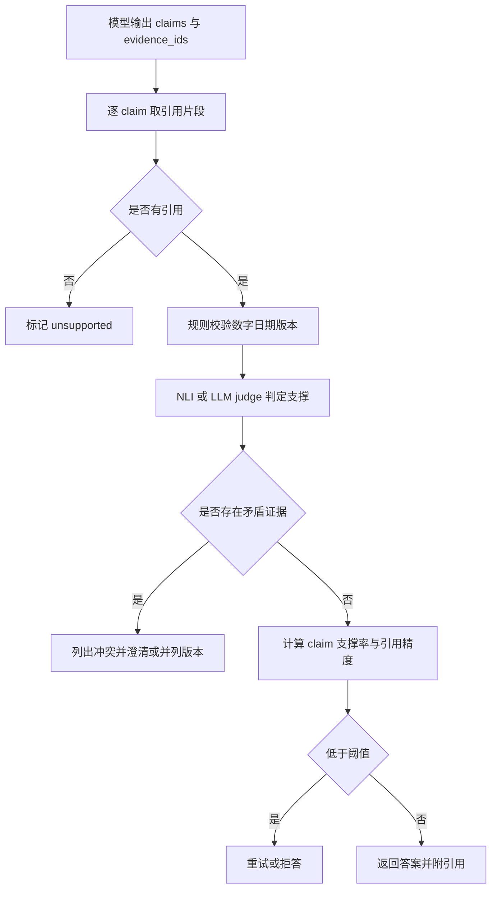

# 答案引用了片段但结论是模型自己编的：claim 级支撑校验与冲突证据处理怎么落地

## 为什么会有这个问题

很多 RAG 系统要求模型给片段编号来提升可信度，但模型常见行为是先给结论再补引用，或只让引用覆盖部分 claim；相似度检索还会把相关但不等价的片段混入上下文，例如旧版本、不同条件、不同权限来源。只看答案级相似度或整体 faithfulness 分数，会被正确 claim 稀释，无法定位哪一句没有证据，也无法处理上下文互相矛盾。工程上需要把忠实度拆成 claim 级支撑关系，并把冲突证据当作显式状态处理。

## 怎么做

1. 生成阶段要求模型输出结构化 claims、evidence_ids 和条件限定；无证据 claim 标记 unsupported，prompt 明确禁止使用片段外事实，遇到冲突要列出冲突而不是强行合成。
2. 校验阶段逐 claim 做支撑判定：数字、日期、版本号先用正则抽取做规则一致性校验，再用 NLI 小模型或 LLM judge 判定 entailed、contradicted、neutral；claim 与证据原文拼接，不能用摘要替代原文。
3. 冲突处理按文档版本、生效时间、来源权威度和权限过滤排序；检测到矛盾证据时降级为澄清问题或多版本并列展示，不直接给单一结论。
4. 建立 claim_support_rate、citation_precision、citation_recall、冲突率等指标，并按 query 类型分桶，避免整体分数掩盖局部失败。
5. 门禁策略：低于阈值触发只基于证据重写或拒答；灰度上线并记录失败 claim 与证据对，回流到 eval set 做回归。
6. 对 judge 做成本分层：规则优先，小模型处理多数 claim，低置信度再走大模型；缓存 claim 加证据对的判定结果，并定期抽样人工校准阈值。

## 关键代码

```python
def verify_claims(answer, evidences):
    claims = answer['claims']
    results = []
    for c in claims:
        ids = c.get('evidence_ids', [])
        if not ids:
            results.append((c['text'], 'unsupported', None))
            continue
        cands = [evidences[i] for i in ids if i in evidences]
        best = max(cands, key=lambda e: nli_score(c['text'], e['text']))
        label = 'entailed' if nli_score(c['text'], best['text']) > 0.7 else 'not_entailed'
        if has_number_conflict(c['text'], best['text']):
            label = 'contradicted'
        results.append((c['text'], label, best['doc_id']))
    support_rate = sum(r[1] == 'entailed' for r in results) / max(len(results), 1)
    return results, support_rate

def answer_with_guard(answer, evidences, threshold=0.8):
    results, rate = verify_claims(answer, evidences)
    if rate < threshold:
        return {'action': 'retry_or_abstain', 'details': results}
    if any(r[1] == 'contradicted' for r in results):
        return {'action': 'ask_clarify_or_show_versions', 'details': results}
    return {'action': 'answer', 'details': results}
```

## 真实场景

某项目客服知识库同时存在旧版和新版退款政策。用户问未发货退款多久到账，top-k 同时召回新旧条款。上线后人工抽检发现答案引用了新版条款编号，但结论写成旧版的到账时间；整体 faithfulness 分数并不低，因为上下文里确实有旧版时间。按 claim 拆解后，发现数值 claim 的 evidence 指向旧片段，citation_precision 低且冲突率上升。修复方式是引入 claim 级校验、版本过滤和冲突降级，并把失败样本回流到回归集。

## 示意图



## 面试官追问

1. **Q：** 为什么不能只用整体 faithfulness 分数做门禁？

   **A：** 整体分数是答案级聚合，部分 claim 无支撑会被其他正确 claim 稀释；judge 对长答案还有位置偏置。claim 级校验能定位具体证据和失败类型，便于重试、拒答和样本回流。

2. **Q：** NLI 或 LLM judge 本身不稳定，怎么控成本和误判？

   **A：** 分层处理：规则先校验数字日期版本，小模型处理多数 claim，低置信度再走大模型；缓存 claim 加证据对；固定 judge prompt 要求输出标签和理由；定期抽样人工校准阈值。


来源：https://github.com/guocong-bincai/ai-interview-guide/blob/main/docs/20-rag-advanced-optimization/README.md
