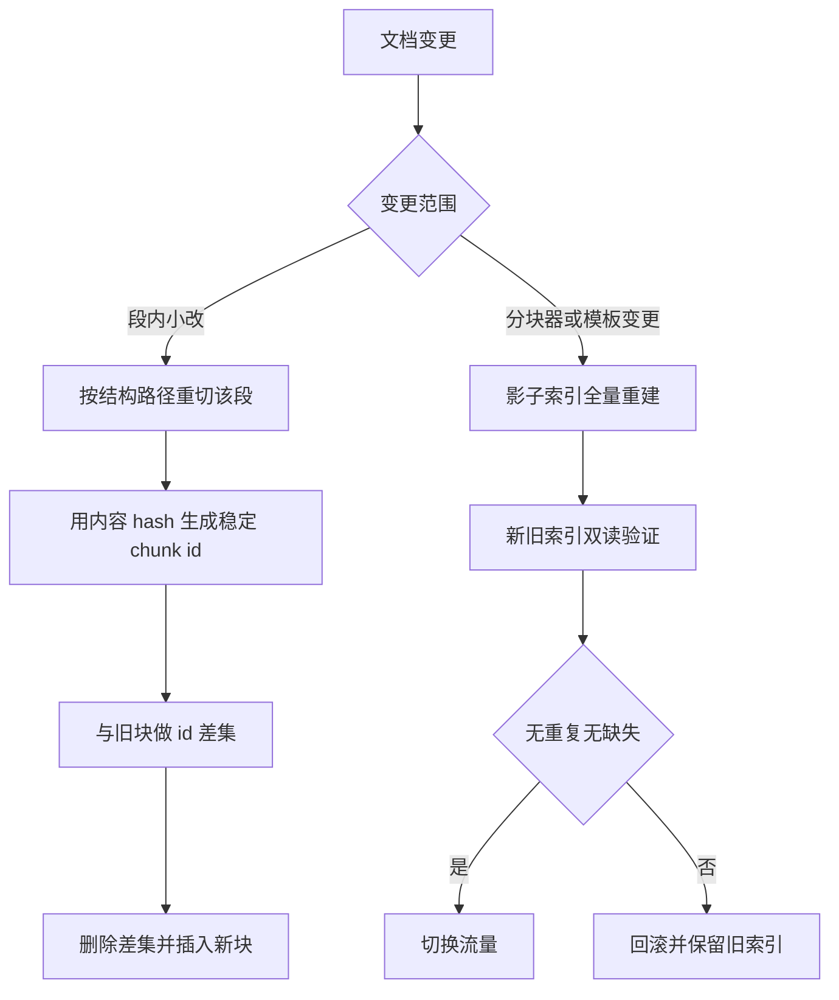

# 语义分块上线后召回提升但每次小改都像全量重建：边界漂移、稳定块 ID 与父子块成本怎么一起控

## 为什么会有这个问题

Semantic Chunking 按句子 embedding 相似度或主题漂移切边界，能减少一句话被切断，但边界依赖阈值、模型版本和全文上下文。文档小改一段可能导致后续边界整体移动，如果 chunk_id 用序号，差集删除会失效，增量更新变成大量删除加插入，出现重复块、旧块残留和索引膨胀。同时块数长尾会推高向量存储和 rerank 成本，所以不能只看召回提升。

## 怎么做

1. 离线评估固定窗口、语义分块、父子块三种方案：比较 recall@k、答案正确率、平均块数、块长 P95，并把成本折算为向量条数乘单价加 rerank token。
2. 稳定化：以段落、标题等结构边界作为硬边界，语义分块只在段内做；设置最小和最大块长；对边界打分做平滑，避免单句抖动。
3. 稳定 ID：chunk_id 用 doc_id 加规范化文本 hash 加结构路径，而不是序号；父块保留稳定 doc 级 ID，便于小块检索大块生成。
4. 更新路径：段内小改只重切该段，用内容 hash 做差集删除和插入；分块器或 embedding 模型变更才走影子索引全量重建。
5. 新旧索引双读一段时间，按 chunker_version 过滤，验证无重复、无缺失后切流；失败则保留旧索引回滚。
6. 监控 chunks_per_doc、平均块长、重复率、孤立块率和更新耗时，把分块版本纳入 eval 回归。

## 关键代码

```python
import hashlib, re

def norm(text):
    return ' '.join(text.strip().lower().split())

def chunk_id(doc_id, section_path, text):
    h = hashlib.sha1(norm(text).encode('utf-8')).hexdigest()[:16]
    return f'{doc_id}:{section_path}:{h}'

def diff_update(old_chunks, new_chunks):
    old_ids = {c['id'] for c in old_chunks}
    new_ids = {c['id'] for c in new_chunks}
    to_delete = old_ids - new_ids
    to_insert = [c for c in new_chunks if c['id'] not in old_ids]
    return to_delete, to_insert

def split_in_section(text, max_len=800, min_len=120):
    sentences = re.split(r'(?<=[。！？.!?])', text)
    chunks, buf = [], ''
    for s in sentences:
        if len(buf) + len(s) > max_len and len(buf) >= min_len:
            chunks.append(buf)
            buf = s
        else:
            buf += s
    if buf:
        chunks.append(buf)
    return chunks
```

## 真实场景

某项目把固定长度分块换成全文语义分块后，召回指标有提升，但文档每次小改都会触发大面积重建；索引条数明显上涨，rerank 延迟变高，还出现同一段落两个版本同时被召回。排查发现语义边界随全文 embedding 变化，chunk_id 用序号导致差集删除失效。修复为结构硬边界加段内语义切分、内容 hash 稳定 ID、局部差集更新，大变更才走影子索引重建。

## 示意图



## 面试官追问

1. **Q：** 语义分块和固定分块的本质区别是什么？现在更常见的实践是什么？

   **A：** 固定分块按长度切，边界稳定但可能切断语义；语义分块按相似度或主题漂移切，召回可能更好但边界不稳定、成本更高。实践中更多采用结构感知加段内语义切分加父子块，而不是全文档自由语义切分，并把 chunker 版本化后纳入评估。

2. **Q：** 小文档频繁更新，是否应该每次重建？

   **A：** 按变更范围决定：段内小改用稳定 ID 做差集局部替换；分块器、模板或 embedding 模型变更才重建。重建走影子索引和双读验证，避免线上混版。


来源：https://github.com/guocong-bincai/ai-interview-guide/blob/main/docs/20-rag-advanced-optimization/README.md
