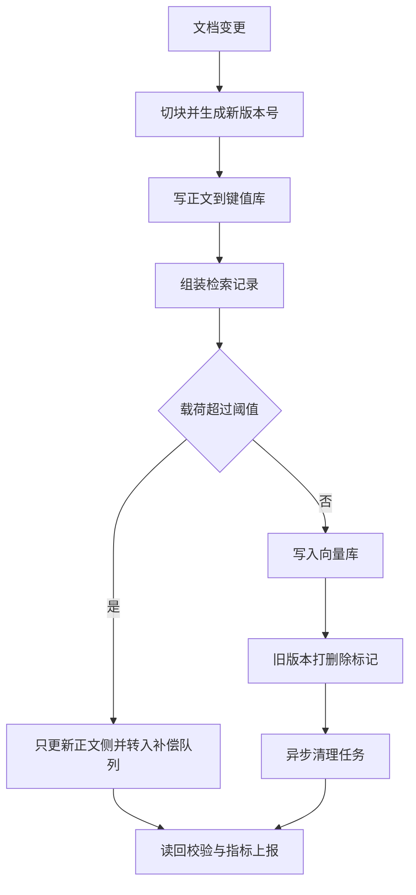

# chunk 正文跟着向量一起 upsert，partial update 撞上消息体上限后静默丢字段：写入契约怎么定

## 为什么会有这个问题

很多团队把 chunk 正文（几百到几千字）、元数据和向量塞进向量库的同一行，图省事少一次查询。但写入路径上不同操作的载荷形态并不一致：批量 insert 走打包序列化，partial update 走逐条变更消息，要受消息队列或 RPC 的单条体积上限约束；而且 partial update 的语义是「只覆盖给出的字段」，没给的字段保持原值还是被置空，取决于实现。常见错误认知有三个：以为 upsert 能覆盖一切场景；以为 partial update 更省带宽所以更安全；以为写入接口返回成功就代表数据可用——实际上向量库多为异步写入，真正的拒绝错误出现在服务端日志或 flush/compaction 阶段。最终症状是：向量还在、能召回，但正文是空或旧版本，模型拿不到证据，答成「没有相关信息」或自行编造。问题本质是把「检索必需的字段」和「展示、校验用的正文」混在同一存储里，导致写入路径被大字段绑架。

## 怎么做

1. 重定写入契约：向量库只保存 id、vector 和少量可过滤标量（tenant、doc_id、version、lang、时间戳、deleted），正文与标题放到 KV、对象存储或搜索引擎，用 chunk_id 关联，检索命中后批量取回正文再做拼装。
2. 改更新语义：内容变更不做「对已有行的半覆盖」，而是生成新 chunk_id 或递增 version 写新行，旧行先打 deleted 标记，再由离线任务按标记清理，避免 partial update 直接改大字段。
3. 加体积守卫：写入前序列化估算字节数，超过阈值（例如 MQ 单条上限的 60%）就拒绝走默认路径，降级为只更新正文侧或按段落拆分，绝不让请求静默失败。
4. 把幂等和重放设计进去：每批写携带 batch_id 和 version，失败落到 outbox 表，重放时按 (chunk_id, version) 去重，保证重复消费不会产生双份召回。
5. 写入后要做读回校验：抽样按 chunk_id 读回，比对正文哈希和 version；同时统计空正文行的占比、写入失败率（按操作类型分）、从写入到可检索的延迟，把「写成功但不可用」变成可观测指标。
6. 给检索侧加防御：拼上下文前校验取回的正文非空且 version 与命中行一致，不一致就丢弃该证据并记录垃圾行计数，宁可少召回也不要拿错版本回答。

## 关键代码

```python
MAX_PAYLOAD = 900_000  # 略低于 MQ 单条上限

def build_record(c, vec):
    # 向量库只放检索必需字段，正文不进向量库
    return {"id": c.chunk_id, "vector": vec, "doc_id": c.doc_id,
            "version": c.version, "tenant": c.tenant, "deleted": False}

def write_chunks(chunks, vecs, store, kv, outbox):
    for c, v in zip(chunks, vecs):
        rec = build_record(c, v)
        if len(json.dumps(rec).encode()) > MAX_PAYLOAD:
            outbox.put("kv_only", c)
            continue
        try:
            kv.put(c.chunk_id, {"text": c.text, "hash": c.hash, "version": c.version})
            store.upsert([rec])
            if c.prev_chunk_id:
                store.update(c.prev_chunk_id, {"deleted": True})  # 打标，异步清理
        except Exception as e:
            outbox.put("retry", {"id": c.chunk_id, "ver": c.version, "err": str(e)})

def read_context(hits, kv):
    ids = [h.id for h in hits if not h.deleted]
    fetched = kv.mget(ids)              # 只取 top-k 的正文，批量一次 RTT
    return [p["text"] for h, p in zip(hits, fetched)
            if p and p["version"] == h.version]
```

## 真实场景

某项目做制度库的日更，运营修改一篇已有文档的正文。现象：新文档 insert 全部正常；修改已有文档后，问答仍返回旧内容，偶尔出现「命中片段但拼不出上下文」，模型答「资料中未提及」。应用日志没有异常，接口返回都是成功；翻服务端日志才看到变更消息因体积超限被拒，且应用侧没有重试。排查路径：先确认写入 API 返回成功并不能证明数据已写入 -> 查服务端异步错误日志和消息体大小 p99 -> 按受影响的 chunk_id 抽样读回，比对正文哈希与 version -> 发现是 partial update 携带整块正文超限被拒，而 insert 走批量打包没有触发上限。修复后空正文行占比和「命中却答不出」的比率同时下降。

## 示意图



## 面试官追问

1. **Q：** 为什么不把正文压缩一下继续放在向量库里？

   **A：** 压缩只是把上限往后推，而且解压占 CPU、正文无法用于过滤和高亮，元数据过滤、引用定位这些需求也做不了。真正的解法是按用途分离：向量库存检索所需的索引数据，正文库存展示与校验所需的内容，顺带还能做取回时的权限二次校验。

2. **Q：** 正文拆出去多了一次 RTT，怎么保证检索延迟不退化？

   **A：** 只对 top-k 的 chunk 做批量 MGET，不逐条取；KV 与向量库同机房部署，并在应用侧加一层按 chunk_id 的 LRU；把这一步计入检索预算，超时则降级为只返回引用而不展开全文。多几毫秒换来写入路径稳定是划算的。


来源：https://github.com/milvus-io/milvus/issues/54374
