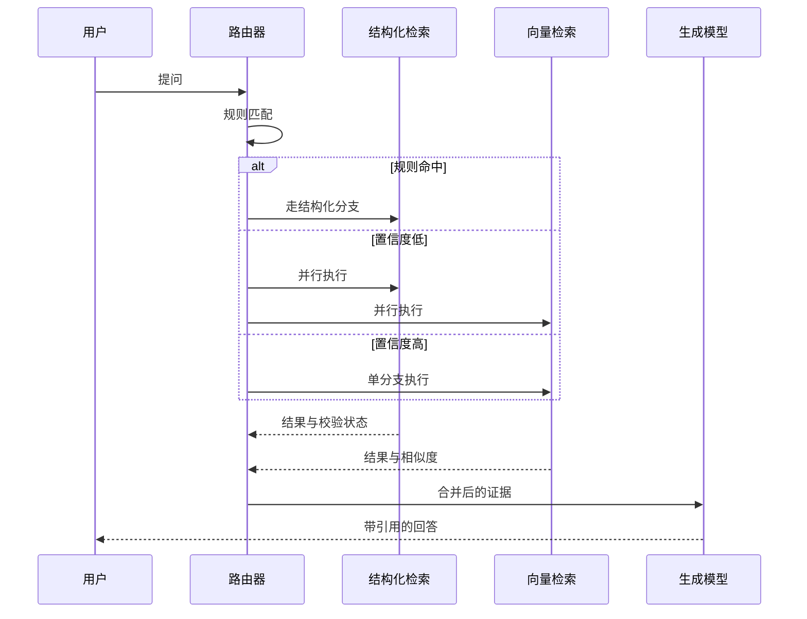

# 让 LLM 自己选检索分支后长尾 query 走错路：路由置信度、并行回退与成本怎么定

## 为什么会有这个问题

知识库往往混合了多种数据：FAQ 短文本、工单和指标类的结构化表、长文档。团队自然想让模型在「向量检索、SQL 查询、关键词检索、直接回答」中选一个分支。问题在于：① 分类器只看 query 文本，看不到库里到底有没有这类数据，无法判断「问了但知识库没有」；② 单一分支、没有回退，判错一次整条链路就白跑，且错误不会暴露成异常，只会变成「答非所问」；③ 模型对措辞很敏感，口语化、多意图、带数字和单位的 query 判错率明显偏高；④ 每次路由多一次模型调用，延迟和 token 成本直接叠加在首字延迟上。常见错误认知是「把路由 prompt 写得更详细就能稳」，实际上 prompt 只能提升先验，真正需要的是可验证的判定加兜底并行。

## 怎么做

1. 规则前置：先用正则、字段名、单位、时间词、编号格式吃掉高确定性的 query（含订单号、指标名、「环比、占比、平均」这类词直接进结构化分支），只有规则判不出来的才交给模型。
2. 让路由输出结构化且带置信度和多标签：要求返回 routes 列表、confidence 和简短 reason，不要让它只吐一个单词；置信度低于阈值时不作单选。
3. 低置信度改并行：路由结果不确定时并行两路（例如结构化检索加向量检索），各自设更小的 top-k 和更短的超时，用融合或优先级合并，避免单点判错导致 0 召回。
4. 定义各分支的可验证成功条件：结构化分支要校验 SQL 执行成功、字段在 schema 内、返回行数大于 0；向量分支用 top1 相似度阈值加 answerability 判定。任何一路满足即视为可回答，全不满足才降级为拒答或转人工。
5. 建立分层评估集：按查询类型（FAQ、指标、多跳、无答案）分别统计路由准确率、端到端正确率、平均分支数、p95 延迟与 token 成本；上线前用 shadow 方式记录「如果走另一条分支会得到什么」，定位是路由错还是分支本身弱。
6. 监控路由分布漂移：各分支占比、低置信度占比、并行触发率、单分支空结果率。分布突变通常意味着文档口径变化或 schema 变更，而不是模型突然变差。
7. 缓存路由决策：query 归一化后缓存 routes，key 必须带上 ACL scope 与索引或数据版本号，权限或数据版本变化时按 scope 失效，避免缓存把结果带偏。

## 关键代码

```python
RULES = [(r"(工单|订单|GMV|占比|环比|平均)", "sql"),
         (r"(怎么申请|办理流程|需要哪些材料)", "vector")]

def route(query, llm):
    for pat, name in RULES:
        if re.search(pat, query):
            return {"routes": [name], "conf": 0.9, "mode": "rule"}
    out = llm.structured(ROUTER_PROMPT,
                         schema={"routes": "list[str]", "confidence": "float"},
                         query=query)
    if out["confidence"] < 0.6 or len(out["routes"]) != 1:
        picks = out["routes"][:2] or ["vector", "sql"]
        return {"routes": picks, "conf": out["confidence"], "mode": "parallel"}
    return {"routes": out["routes"], "conf": out["confidence"], "mode": "single"}

def retrieve(query, plan, branches, budget):
    for name in plan["routes"]:
        b = branches[name]
        r = b.search(query, top_k=budget.k(plan["mode"]), timeout=budget.t(plan["mode"]))
        if r and r.top_score >= b.min_score:
            return r                      # 任一路可验证成功即可回答
    return None                           # 全部失败才走拒答/转人工
```

## 真实场景

某项目做客服 Copilot，知识库既有制度文档也有工单指标表。症状：问「上个月这类工单的平均处理时长」时，答案里的数字对不上，日志显示 query 像自然语言被路由到向量检索，而向量库里只有文档、没有指标表，于是返回几段相似制度文档，模型据此编了数值；同时首字延迟 p95 上升，因为每条 query 都多了一次小模型调用。排查路径：抽样一批错例按路由分支分组 -> 发现含「平均、多少、占比」的指标类 query 大量被判成 vector -> 补规则前置并把低置信度改为并行两路 -> 指标类正确率回升，而成本只在少数低置信度 query 上多花一次检索。

## 示意图



## 面试官追问

1. **Q：** 并行多路会放大成本，你怎么权衡？

   **A：** 只在低置信度区间并行，这一区间占比通常不高；并行分支强制更小的 top-k 和更短超时，把额外成本锁在上界。比较对象是「多花一次检索」与「答错一次导致转人工或投诉」的代价，后者通常更贵；如果预算紧，可以先只保留规则加单分支，把并行作为兜底开关。

2. **Q：** 路由缓存怎么防止权限或数据版本变化后带出错误结果？

   **A：** 缓存 key 里加入 query 归一化文本、用户可见的 ACL scope 和索引或数据版本号，任一变化都会自然换 key；同时对缓存命中率按 scope 拆分监控，避免某个 scope 命中率异常高说明 key 设计漏了维度。


来源：https://github.com/cdavid817/agent-interview/blob/main/docs/02-capabilities/rag/embedding-vector-1.md
