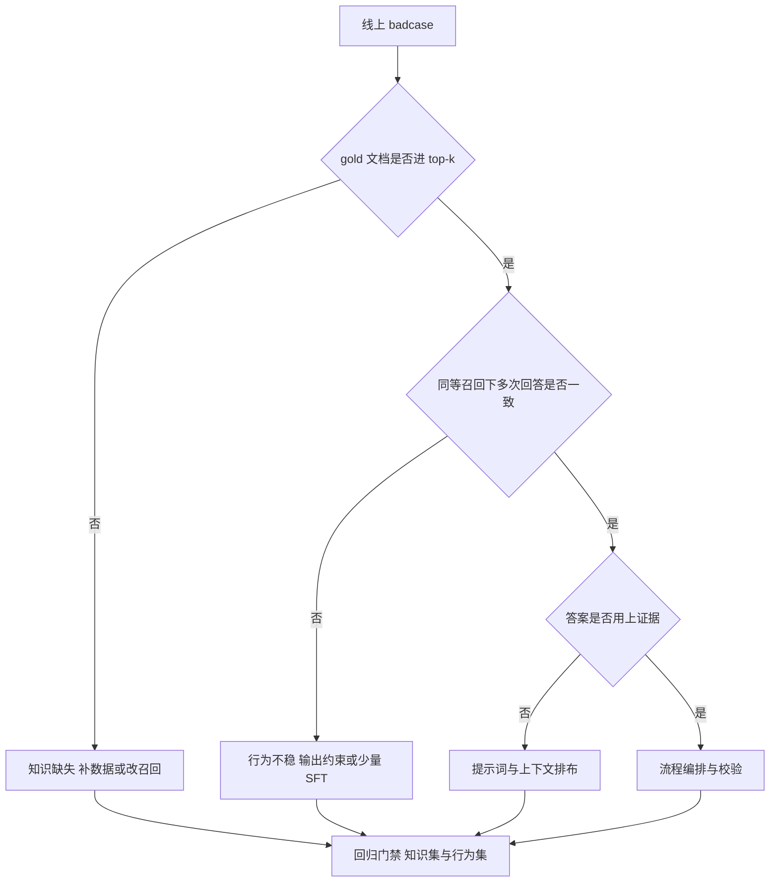

# 知识经常变却用 SFT 灌进去，两周后模型还在答旧政策：RAG、微调与规则层的职责怎么切、回归验证怎么做

## 为什么会有这个问题

团队遇到答不准时第一反应是「模型不行，微调一下」，于是把产品文档、政策条款、FAQ 全部做成 SFT 数据。问题在于：参数化记忆没有 TTL、不能按单条失效、不能按用户权限过滤、也无法溯源引用，知识一旦进权重就只能靠再训一次覆盖，而 base model 升级又会把上一次的知识全部丢掉。反过来说，RAG 也治不了所有病：输出格式不稳定、领域缩写解读错误、该拒答时硬答、工具调用参数不规范，这些是「行为分布」问题，靠检索塞上下文往往越塞越乱。真实工程里必须先把「缺知识 / 行为不稳 / 流程没设计好」切开，再决定是补索引、写约束还是上 SFT，否则两个手段互相背锅。

## 怎么做

1. 建立 badcase 归因表：每条失败样本必须落盘 query、召回 top-k 的 doc_id 与分数、gold 文档是否命中、模型答案、人工判定标签（缺证据 / 有证据没用上 / 多次回答不一致 / 流程走错），没有这张表就没有选型依据。
2. 按归因分流：gold 文档不在 top-k → 知识缺失或召回问题，走补数据、改切分、加词法通道；gold 在但答案没用到 → 提示词与上下文排布、引用契约；同一 query 同等召回下多次采样答案不一致 → 行为不稳；多步任务中间步骤错 → 编排与工具契约。
3. 只有当「证据齐全但模型持续不遵守输出规范或不懂领域表述」时才考虑 SFT，且训练集里不放易变事实，只放行为样本：引用格式、拒答话术、字段解读、工具参数范式。
4. 采用混合形态：RAG 提供事实与权限边界，SFT 只教「怎么用检索结果说话」；用 LoRA 小学习率，混入 10%–20% 通用指令与「依据上下文作答」样本抵抗遗忘。
5. 把「不改模型就能改」的东西全部下沉到规则层：schema 约束解码、答案校验器、低置信度转人工、路由规则，这些才能按天迭代。
6. 建回归门禁：把评测集拆成知识子集与行为子集，任何一次 prompt、切分、索引参数或 SFT 版本变更都要跑双集，知识集不允许下降，行为集看格式合规率与拒答准确率，通过后灰度。
7. 版本治理：索引侧支持热更新与 alias 切换；SFT 版本必须绑定 base model 版本，base 升级视为重训，不能默认继承。

## 关键代码

```python
def triage(case):
    docs = case["retrieved"][:10]
    if not ({d["doc_id"] for d in docs} & set(case["gold_doc_ids"])):
        return "knowledge_missing"       # 补文档、改切分、加召回通道
    used = any(g in case["answer"] for g in case["gold_spans"])
    answers = {r["answer"] for r in case["repeats"]}
    if len(answers) > 1 and all(r["top5"] == case["top5"] for r in case["repeats"]):
        return "behavior_unstable"       # 约束解码、schema、少量 SFT
    if not used:
        return "prompt_or_context"       # 引用契约、上下文排布
    return "workflow"                    # 路由、工具契约、流程校验


def decide(counts, total):
    share = {k: v / total for k, v in counts.items()}
    plan = []
    if share.get("knowledge_missing", 0) > 0.5:
        plan.append("fix_retrieval_first")   # 此时微调几乎无收益
    if share.get("behavior_unstable", 0) > 0.2:
        plan.append("constrain_then_sft")
    if share.get("workflow", 0) > 0.15:
        plan.append("refactor_orchestration")
    return plan
```

## 真实场景

某项目做内部制度问答，运营每两周改一次报销与假期政策，团队最初把政策条文做成 SFT 数据，上线初期效果很好。两周后出现两类症状：一是用户问新政策时模型给出旧金额且语气非常肯定，检索日志里新文档其实已被召回，但模型答案与上下文冲突；二是同一个问题，一次带引用一次不带，格式合规率只有七成左右。排查路径：先跑归因表，发现知识缺失只占少数、大部分是「有证据没用上」和「多次回答不一致」；再对比 SFT 前后在知识子集上的表现，确认微调把「优先相信权重」这个偏好带了进来。最终把政策事实全部退回索引层，SFT 只保留引用格式与拒答行为的样本，并把格式校验下沉为输出 schema 校验，旧模型版本按 alias 回滚。

## 示意图



## 面试官追问

1. **Q：** 如果 SFT 之后行为集变好但知识集明显下降，你怎么处理？

   **A：** 先确认不是评测集与文档版本错位；然后按灾难性遗忘处理：降低 LoRA rank 与学习率、缩短步数、在训练集里混入「仅依据给定上下文作答」和通用指令样本；同时把知识类问题在推理侧强制走 RAG，并在 prompt 里明确上下文优先于参数记忆。若仍下降，说明这批 SFT 数据本身在教模型「凭记忆答」，应删样本而不是继续调参。

2. **Q：** 为什么不干脆把全部文档塞进长上下文，省掉索引和微调的争论？

   **A：** 成本、权限与更新粒度三方面都不成立：长上下文按 token 计费且每轮重复付费；文档级权限过滤在拼接前就要做，长文直塞很难保证不越权；一次政策改动要重建整个 prompt 缓存。长上下文适合「少量、稳定、同一租户」的材料，知识型、多租户、频繁变更的场景仍然要靠检索分层。


来源：https://github.com/guocong-bincai/ai-interview-guide/blob/main/docs/03-rag-system/README.md
