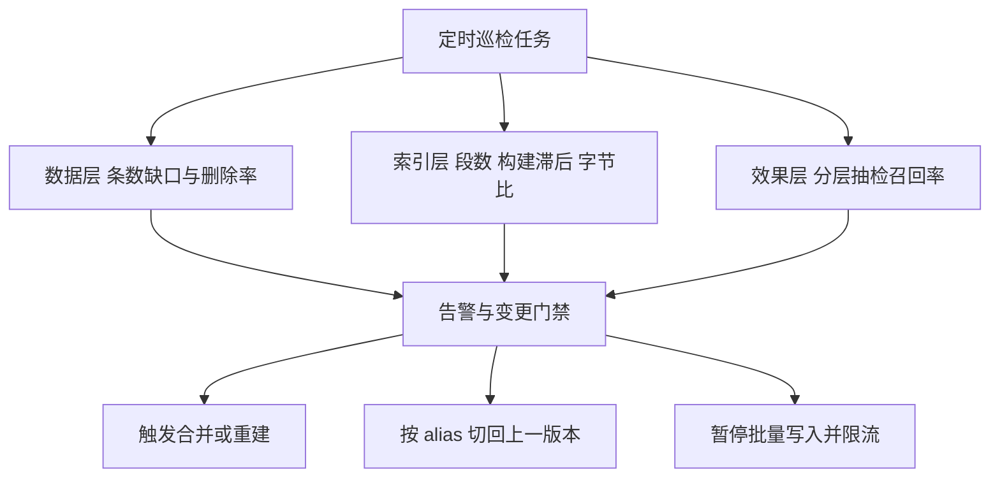

# 服务指标全绿但用户说新文档搜不到：向量索引的健康度该监控哪些层、抽检召回怎么建

## 为什么会有这个问题

向量库的故障几乎都是静默的：不会抛 5xx，也不会让 p99 变红，只会让召回一点点变差。原因在于 ANN 索引本身是近似结构且异步维护——删除是打墓碑、更新是写新段、段合并与索引构建在后台跑、量化与剪枝有损，任何一环滞后都只体现在「结果里少了几条」。只监控 QPS、延迟、错误率等于没监控；只看向量条数也不够，条数对但内容过期、删除未生效、部分 partition 没重建，都会让条数看起来完全正常。必须把数据层、索引层、效果层分开定义指标，并用带 gold 的抽检集持续验证真实召回。

## 怎么做

1. 数据层指标：期望条数（由上游文档 manifest 与切分版本推算）与实际 num_entities 的缺口、删除率 tombstone ratio、最新一条写入的时间水位、以及每个 partition 的向量数与文档数是否同比例。
2. 索引层指标：段数量与单段大小分布、索引构建滞后 build lag（写入成功到可被检索的时间差）、索引字节与原始向量字节之比（判断是否膨胀或未压缩）、内存驻留率与是否落盘、索引版本号。
3. 效果层指标：分层抽检集的 recall@k 与 nDCG、空结果率、top1 相似度分数分布漂移、拒答率；分数分布漂移往往先于 recall 下降出现，是最早的信号。
4. 抽检集建设：200–500 条 query，按业务类目分层并显式覆盖长尾，每条绑定当前文档版本的 gold doc_id；文档改版时必须重标，否则监控会长期失真。定时任务跑结果写入时序库，与上一基线比较。
5. 线上 trace 关联：每次请求记录 top-k 的 doc_id、score 与 index_version，badcase 可原样回放，直接判断是「没召回」还是「召回了没用上」。
6. 告警分级与处置动作：效果层跌超过阈值 → 通知并考虑切回上一 alias；build lag 超阈值 → 暂停批量写入或降级读旧索引；删除率过高 → 触发 compaction 或重建；变更（换 embedding、改切分、调参）必须跑同一套抽检集才允许放量。

## 关键代码

```python
def inspect(store, golden, baseline, dim=1536):
    s = store.stats("kb")
    alive = s["num_entities"]
    expected = store.manifest_chunks("kb")
    tomb = s["deleted"] / max(s["inserted"], 1)
    bloat = s["index_bytes"] / max(alive * dim * 4, 1)
    ok = sum(1 for q, g in golden
             if {d["doc_id"] for d in store.search(q, k=10, partition="kb")} & g)
    recall = ok / len(golden)
    alerts = []
    if alive < expected * 0.95:
        alerts.append("count_gap")
    if tomb > 0.30:
        alerts.append("tombstone_high")
    if bloat > 1.6:
        alerts.append("index_bloat")
    if recall < baseline["recall"] - 0.03:
        alerts.append("recall_drift")
    if store.build_lag_seconds() > 900:
        alerts.append("build_lag")
    return {"recall@10": round(recall, 3), "tombstone": round(tomb, 2),
            "alerts": alerts}
```

## 真实场景

某项目上线三个月，看板上 QPS 平稳、p99 正常、错误率为零，但陆续有用户反馈「上周上传的文档问不到」。排查路径：先核对写入侧，SDK 调用全部返回成功；再看索引层，build lag 曲线在白天持续爬升，段数量随每日增量单调增长，删除率因频繁重刷同一批文档已接近四成而合并没跟上；再用抽检集跑效果层，recall@10 相对基线缓慢下滑，空结果率同时抬升——说明不是写入失败，而是可检索性与索引结构在退化。处置是限制批量写入速率、触发 compaction、按 alias 切到重建后的索引，并把删除率与 build lag 加进告警。另一类事故是换 embedding 时只重建了部分 partition，同一集合里混了两套向量空间，条数完全正常但相似度不可比，靠 index_version 维度的抽检对比才定位到。

## 示意图



## 面试官追问

1. **Q：** 抽检集怎么选才不会被误导？

   **A：** 分层抽样而不是随机抽样，长尾类目必须有代表样本；gold 要绑定文档版本，文档改版即重标；定期用线上真实 query 补充，并结合采纳、点击、人工纠错等信号扩充难例。同时监控抽检集自身的命中率分布，如果某类目长期全对或全错，说明该层样本已经失去区分度。

2. **Q：** 只监控 recall 够不够？

   **A：** 不够。recall 只反映「能不能捞到」，不反映「捞到之后有没有用上」，也不反映延迟和成本。要同时看空结果率、top1 分数分布漂移（阈值会跟着失效）、索引字节与构建滞后。诊断时用 trace 把召回结果和最终答案对齐，才能区分是检索问题还是生成与流程问题。


来源：https://github.com/guocong-bincai/ai-interview-guide/blob/main/docs/06-vector-index-optimization/README.md
