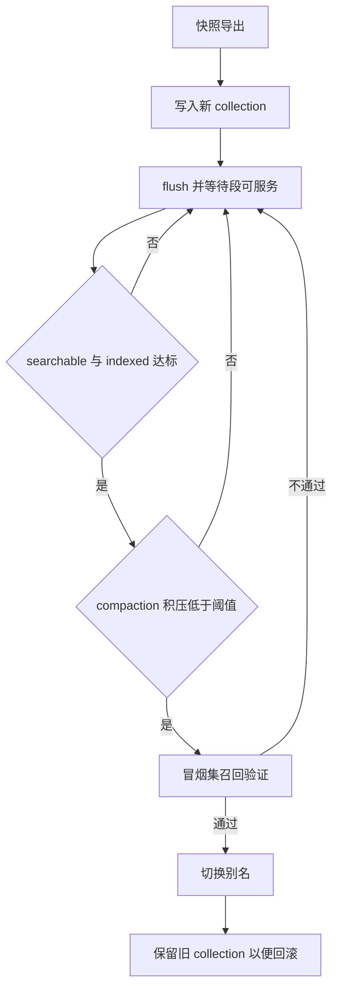

# 全量重建 RAG 索引时导入很快、可检索却晚了数小时：导入后 compaction 与段可见性怎么算进重建窗口

## 为什么会有这个问题

很多团队用「导入吞吐」估算重建窗口，把写入任务完成当成索引可用；但向量库内部通常是分段写入 + 后台合并 + 建索引 + 段发布，导入只完成了日志与原始段落盘，真正可高效检索要等索引构建完成、段发布、compaction 收敛。逐条 upsert 会制造大量小段，后台合并与在线查询抢 CPU/IO，导致「导入 40 分钟、可服务却拖到几小时后」，同时在线 p99 抖动。另一个常见错误认知是只看导入任务的成功状态，不看 searchable/indexed 比例、段数量与后台任务积压，于是把「搜不到新文档」误判为应用层缓存或 embedding 问题。

## 怎么做

1. 先把重建拆成四个可观测阶段：写入接收完成、段可服务（searchable）、索引构建完成（indexed）、后台 compaction 积压归零。每个阶段都设门禁，而不是只看导入任务退出码。
2. 在 staging 用与生产同规模、同更新比例的数据做基准，记录不同 batch size 与并发下的导入吞吐、段数量增长、compaction backlog 曲线，把重建窗口算成「导入 + 索引构建 + 合并收敛 + 灰度切换 + buffer」，不要用单次小样本外推。
3. 控制写入形态：优先用 bulk import 通道而非逐条 upsert；按时间或业务分区重建到新 collection，稳定后切别名；避免边导边大批量删除，减少 tombstone 与写放大。
4. 做资源隔离与限流：给 compaction 设并发上限或错峰执行，让在线 query 节点与重建写入不共享同一批 CPU/IO；导入窗口避开业务高峰。
5. 建立切换门禁与回滚：searchable 比例达标、段数量与行数比例合理、compaction backlog 低于阈值、冒烟集召回通过，才允许切别名；旧 collection 保留一段时间用于回滚。
6. 上线后持续监控 segment 数、indexed ratio、后台任务积压、查询 p99 与召回抽检，防止「一次性重建成功、日常增量又把段数堆回去」。

## 关键代码

```python
import time

def rebuild(alias, new_collection, client, max_backlog=50, timeout=6 * 3600):
    client.create_collection(new_collection)
    bulk_import(client, new_collection, source="snapshot/latest")
    client.flush(new_collection)

    deadline = time.time() + timeout
    last = {}
    while time.time() < deadline:
        last = client.get_collection_metrics(new_collection)
        ready = (
            last["searchable_ratio"] >= 0.999
            and last["indexed_ratio"] >= 0.999
            and last["compaction_backlog"] <= max_backlog
            and last["segment_count"] <= max(8, last["rows"] // 200_000)
        )
        if ready and smoke_test(client, new_collection):
            client.switch_alias(alias, new_collection)
            return True
        time.sleep(60)
    raise TimeoutError(f"rebuild not ready: {last}")
```

## 真实场景

某项目夜间做全量重建：导入任务约一小时就显示完成，但新文档到第二天早上才稳定可搜，期间在线查询 p99 明显抬升。排查发现写入走的是逐条 upsert，产生大量小段，后台 compaction 持续积压并与在线查询抢 IO；运维只监控了导入任务成功率，没有监控 searchable 比例与段数量。改为快照 bulk import + 新 collection 重建 + 指标门禁后，可服务时间点变得可预测，切别名前也能提前发现未就绪。

## 示意图



## 面试官追问

1. **Q：** 直接把 compaction 并发调大不就能缩短窗口吗？

   **A：** 不一定。瓶颈可能在单分片、磁盘 IO 或索引构建线程，盲目提高并发会加剧写放大并与在线查询抢资源，表现为导入更快但查询长尾更差。应先定位瓶颈在 CPU、IO 还是段数量，再做限流与错峰，而不是只调大并发。

2. **Q：** 怎么判断「新文档搜不到」是段未发布、索引未建完，还是应用缓存？

   **A：** 分层验证：先按主键做精确查询，能中说明数据已写入；再做向量查询，不能中多为索引未就绪或段未发布。对照 searchable/indexed 指标与 segment 状态；最后在应用侧带 trace 重放，确认是否命中语义缓存或旧别名。


来源：https://github.com/milvus-io/milvus/issues/50593
