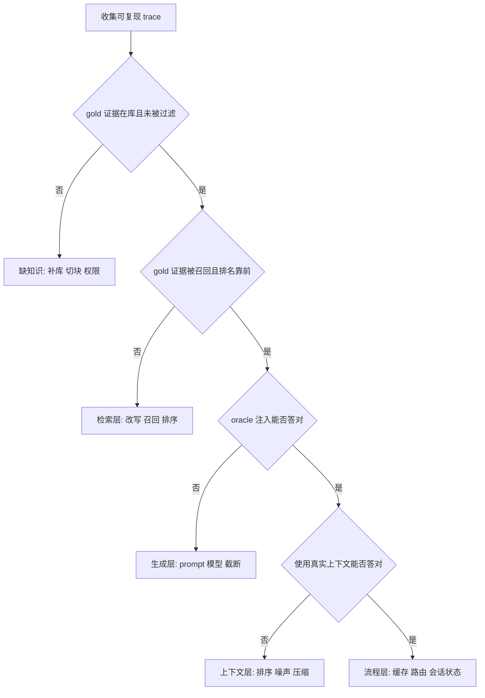

# 同一个问题昨天答对今天答错、trace 里检索却都命中：缺知识、行为不稳与流程缺陷怎么分层归因

## 为什么会有这个问题

RAG 回答不好往往被笼统归因为「模型不行」或「知识不够」，但真实原因分布在四层：知识层（文档没入库、切块丢内容、权限过滤把证据删掉）、检索层（没召回、排名低、被噪声淹没）、生成层（有证据仍答错、prompt 遵循差、上下文截断）、流程层（路由走错、工具没调、语义缓存返回旧答案、会话状态污染）。缺少固定输入快照与分层指标时，任何单点修改都无法验证，还会出现「改 prompt 治好了个例、整体回归变差」。另一个常见错误认知是线上日志能直接复现，实际上模型温度、缓存、索引版本与 query 改写都会让结果不可复现。

## 怎么做

1. 先固化可复现证据：记录原始 query、改写后 query、filters、top-k 文档 id/分数/版本、prompt 版本与 hash、模型与采样参数、工具调用链、命中的缓存键、最终答案。没有这些就无法 replay。
2. 做分层判定而不是直接改 prompt：第一步确认 gold 证据是否在库且未被权限/切块丢弃；第二步确认是否被召回及排名；第三步做 oracle 注入，把 gold 证据直接喂给模型看能否答对；第四步检查路由、工具与缓存是否走对。
3. 用对照实验隔离变量：同一 prompt 与证据换温度或模型；同一模型换检索结果；关闭缓存重放；固定采样参数。一次只动一个变量，避免「补了文档又改了 prompt」导致归因失效。
4. 建立小规模分层回归集，按失败类型打标签（缺知识/未召回/生成错误/流程错误），每次改动跑同一批样本，统计各层通过率与拒答率，而不是只看整体准确率。
5. 按归因结果修复：缺知识补库、修切块与权限；未召回调召回与改写；生成层收紧 prompt、降温度、加结构化校验或 claim 支撑检查；流程层修路由规则、工具契约与缓存键/失效策略。
6. 把分层指标与抽检做成日常门禁：新文档入库抽检、缓存命中抽检、模型或 prompt 变更前后回归，避免同类问题反复出现。

## 关键代码

```python
def diagnose(case, rag, llm):
    q = case["query"]
    ctx = rag.retrieve(q, filters=case["filters"], trace=True)

    if not rag.exists(case["gold_doc_id"], filters=case["filters"]):
        return "缺知识: 文档未入库或被切块/权限过滤"

    if case["gold_doc_id"] not in [d.id for d in ctx.docs]:
        return "检索层: 未召回或排名过低"

    oracle = llm.answer(q, evidence=[case["gold_text"]], temperature=0)
    if not case["judge"](oracle, case["gold_answer"]):
        return "生成层: 有证据仍答错, 查 prompt/模型/截断"

    base = llm.answer(q, evidence=ctx.docs, temperature=0)
    if not case["judge"](base, case["gold_answer"]):
        return "上下文层: 排序或噪声导致证据被淹没"

    return "流程层: 缓存/路由/会话状态或评测口径"
```

## 真实场景

某项目客服 RAG 出现「同一问题上午答对、下午答错」，日志显示两次都召回了同一篇文档。分层 replay 后发现：一部分是语义缓存命中了旧答案；一部分是权限过滤把关键段落删掉后模型仍然编造；还有一部分是 query 改写把产品型号写错导致根本没召回。此前团队一直在调 prompt，整体指标没有改善；按层打标签后，修复分别落到缓存键与失效、权限与切块、改写规则与召回阈值上，回归集通过率才稳定提升。

## 示意图



## 面试官追问

1. **Q：** 怎么区分「检索没召回到」和「召回了但模型没用」？

   **A：** 做 oracle 注入：把 gold 片段直接放在上下文首位喂给模型，若答对说明生成层可用，问题在召回或排序；若仍答错则查 prompt 约束、上下文长度截断与模型参数。再用原始召回结果对照，就能把两层拆开。

2. **Q：** 线上没有人工标注，怎么低成本做归因？

   **A：** 用 LLM-as-judge 对「证据是否充分」「答案是否被证据支撑」打分，并人工抽检校准 judge 的一致性；按 query 聚类采样而不是全量跑，优先覆盖高频与高风险意图，同时保留原始 trace 以便复核。


来源：https://github.com/didilili/ai-agents-from-zero/blob/main/1-3-RAG%E3%80%81%E5%BE%AE%E8%B0%83%E3%80%81%E7%BB%AD%E8%AE%AD%E4%B8%8E%E6%99%BA%E8%83%BD%E4%BD%93%E9%80%89%E5%9E%8B.md
