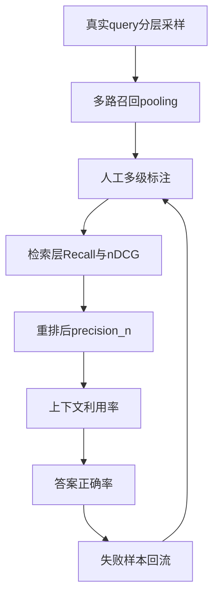

# 离线 Recall@10 涨到 0.9，线上答案正确率却没动：检索评估集的标注方式与指标漏斗怎么对齐

## 为什么会有这个问题

绝大多数团队的检索评测集是「一条 query 对应一个 gold chunk」，但真实文档中同一问题往往有多个正确片段，甚至需要跨文档互补。单 gold 标注会系统性低估 Recall，也会让「把 gold 排进 top-K」变成依赖切块边界的运气。更隐蔽的偏差来自 query 的构造方式：用 LLM 从 chunk 反向生成 query，会天然与原文词汇高度重合，让 dense 和 sparse 分数一起虚高，分布与真实用户输入（口语、指代、多约束、编号）严重不一致。再往上一层是指标与业务目标错位：Recall@K 只回答「gold 是否进了候选池」，而最终答案取决于 rerank 后进 prompt 的那 n 条有没有被模型用上。K 越大 Recall 越好看，但对生成毫无帮助。常见错误认知是把 Recall@K 的小幅提升当作系统提升，不做置信区间就对比两个模型，也不区分「没检索到」和「检索到但没用上」这两类完全不同的故障。

## 怎么做

1. 先把相关性定义成多级而不是二值：2 = 可直接作答的片段，1 = 必要的上下文或部分答案，0 = 无关；同一 query 允许多个 gold，来源用 pooling（多路召回 top-k 的并集再人工标注未标注项），避免只标已知片段。
2. 固定 query 的真实分布：从线上日志脱敏采样，按意图分层（自然语言问句、型号编号、条款约束、对比、多跳），每层保证足够样本量；LLM 生成 query 只作补充且必须人工改写以消除词汇泄漏。
3. 指标分层报告：检索层看 Recall@K 与 nDCG@K（多级相关、多 gold 时用 nDCG，单 gold 只关心排名时用 MRR），并明确「评测用的 K」与「线上实际进 prompt 的 n」是两个口径，输出 Recall@K 到 Recall@n 的衰减曲线。
4. 做漏斗分解：retrieval recall@n × rerank precision@n × 上下文利用率（答案句是否落在给到的片段里）× 答案正确率。定位到哪一层卡住，就不会被上层的指标上涨误导。
5. 版本对比必须带不确定性：同一评测集上做配对 bootstrap 或检验，避免把 0.02 的噪声当提升；同时保留一份不参与调参的回归集，防止在评测集上过拟合。
6. 上线后做离线—在线对齐：定期抽样线上 query 回放，人工判断是否「本该召回却没召回」，把新出现的失败样本回流进评测集，形成闭环。
7. 每次改动切块策略或 K 时，同步重建 gold 与 chunk 的对齐关系（按区间覆盖判定，而不是比较 chunk id），否则指标前后不可比。

## 关键代码

```python
import numpy as np, math

def ndcg(rels, k=10):
    rels = rels[:k]
    gains = [(2**r - 1) / math.log2(i + 2) for i, r in enumerate(rels)]
    ideal = sorted(rels, reverse=True)
    idcg = sum((2**r - 1) / math.log2(i + 2) for i, r in enumerate(ideal))
    return sum(gains) / idcg if idcg else 0.0

def paired_bootstrap(a, b, n=2000, seed=0):
    rng = np.random.default_rng(seed)
    a, b = np.asarray(a, float), np.asarray(b, float)
    idx = rng.integers(0, len(a), size=(n, len(a)))
    diff = (a[idx] - b[idx]).mean(axis=1)
    lo, hi = np.percentile(diff, [2.5, 97.5])
    return diff.mean(), lo, hi

# 用法：逐 query 算 ndcg@10 得到两版向量，再跑 paired_bootstrap 看区间是否跨 0
```

## 真实场景

某项目为了提升召回，把 chunk 从 512 token 降到 256 token，离线 Recall@10 从 0.63 升到 0.88，团队据此全量重建索引。上线后人工抽检数百条失败会话，答案正确率几乎没动。排查路径：先看真正进 prompt 的 top-5，Recall 只有 0.66——因为原来的 gold 被切碎成多个小块，Recall@10 是靠「多塞几块」涨上去的；再看上下文利用率，5 块里平均只有 1 块左右被答案引用，其余是高度重复的相邻片段；最后回到评测集本身，发现大部分 query 只有 1 个 gold，且由 LLM 从该 chunk 反向生成，词汇重合度极高。修正动作：用 pooling 重建多 gold 多级标注，口径改为 Recall@5 与 nDCG@5 双报，并在漏斗里增加「去重后有效块数」这一指标。

## 示意图



## 面试官追问

1. **Q：** 只有单 gold 的时候，Recall@K 还能用吗？

   **A：** 能用但要改口径：它退化成 HitRate@K，只能回答「唯一正确项是否进池」。前提是 K 固定、切块策略不变；一旦切块变了，单 gold 会严重失真，必须先把 gold 与 chunk 做区间覆盖对齐，再比较不同切块方案。

2. **Q：** nDCG 和 MRR 应该选哪个？

   **A：** 多级相关（0/1/2）或一个 query 对应多个相关片段时用 nDCG，它同时衡量位置与相关度增益；只有一个正确项、且只关心它排第几时 MRR 更直观也更稳。排序差异集中在头部时 MRR 敏感，长尾相关集合更适合 nDCG。生产上建议两个都报，避免单指标被优化。


来源：https://github.com/guocong-bincai/ai-interview-guide/blob/main/docs/06-vector-index-optimization/README.md
