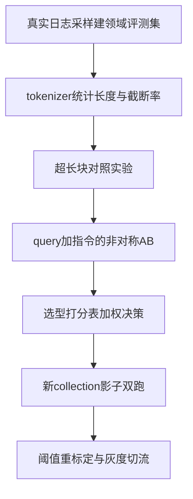

# 榜单分数最高、上线后型号与条款后段却搜不到：embedding 选型的领域实验与 tokenizer 截断边界怎么验

## 为什么会有这个问题

模型卡上的 max tokens 与「有效表征长度」不是一回事：多数 embedding 模型在几百 token 之后注意力明显衰减，超出部分被 SDK 静默截断且不报错。这种丢失发生在写入侧，查询侧完全无感知，症状只是「某些问题永远命中同一条款的前半段」。另一层问题在评测口径：公开榜单以通用语料和对称任务为主，而真实 RAG 是「短 query 检索长 passage」的非对称任务，模型若经过 instruction 训练，query 侧需要加前缀、document 侧不加，方向用反了会掉点。常见错误认知是维度越高越好、参数越大越好、榜单平均分高就能直接用；实际取舍还包括维度带来的索引内存与延迟、长上下文模型带来的写入 token 成本、以及多语言与 license 约束。

## 怎么做

1. 先建领域评测集：从真实日志抽 query，按类型分层（自然语言问句、型号编号、缩写别名、跨语言），每类保证样本量，标注 gold；同时构造 hard negative（同文档相邻块、同型号不同版本），用来检验区分度而不只是召回。
2. 量化截断：用候选模型自带的 tokenizer 统计现有 chunk 的 token 分布，算出超过有效长度的比例；对超长块做对照实验（原样、按 tokenizer 切分、只保留前 N token），确认召回损失是否真由截断造成。
3. 验证非对称与指令：按模型卡要求只给 query 加 prefix/instruction，document 侧保持原样；做加与不加的 A/B，很多模型有可观提升，但方向用错会掉点，必须实测。
4. 建立选型打分表：领域 Recall@10 / nDCG@10、维度与存储成本、单条 embedding 的延迟与吞吐、多语言覆盖、能否自托管与 license，加权后再决策，不只看单一分数。
5. 切换工程化：新建影子集合全量写入新向量（新旧向量绝不能混在同一 collection），双跑对比检索与端到端指标，灰度切流量；同时重标定下游相似度阈值与拒答阈值，因为分布已经变了。
6. 写入侧兜底：入库前用 tokenizer 校验长度，超限就切块或改用父子块（子块检索、父块喂给 LLM），并在流水线里把「截断率」做成常驻监控指标。

## 关键代码

```python
from transformers import AutoTokenizer

def truncation_report(texts, model_id, effective_len=512):
    tok = AutoTokenizer.from_pretrained(model_id)
    lens = [len(tok.encode(t, add_special_tokens=False)) for t in texts]
    lens_sorted = sorted(lens)
    p95 = lens_sorted[int(0.95 * (len(lens_sorted) - 1))]
    over = sum(1 for n in lens if n > effective_len)
    return {
        "count": len(lens),
        "p95_tokens": p95,
        "max_tokens": lens_sorted[-1],
        "effective_len": effective_len,
        "truncated_ratio": over / len(lens),
    }

# 同一个 tokenizer 复用为入库前校验；truncated_ratio 超阈值即告警
```

## 真实场景

某项目为省存储把向量从高维换成一个维度减半的新模型，公开榜单只差一点，于是同时替换了写入侧与查询侧。上线后「长条款类」问题错误率上升，典型症状是：问某条款后半段的条件时，检索命中的永远是同一条款的前半段。排查路径：统计 chunk 的 token 分布，发现 p95 已经超过模型的有效长度，截断比例不低；用 hard negative 实验看到新旧模型对「同型号不同版本」的区分度差异明显；最后确认新模型需要 query instruction 而旧模型不需要，切换时漏了这一步。修正动作：按目标 tokenizer 重新分块并引入父子块、query 侧补上 instruction、新 collection 影子双跑后灰度切流。

## 示意图



## 面试官追问

1. **Q：** 为什么不能直接覆盖写进现有 collection？

   **A：** 维度和模型都变了，向量空间不可比，混在一起做近邻检索会互相串；而且覆盖写期间新旧混杂，无法回滚、无法对比。正确做法是新建 collection 全量写入，影子流量双跑，指标对齐后再切读、最后下线旧集合。

2. **Q：** 降维一定会掉召回吗？

   **A：** 不一定，取决于数据本征维度和模型是否原生支持降维（如 Matryoshka 式表示）。但必须用领域评测集加 hard negative 验证，并对长尾类目单独看指标；如果是后处理截断维度，还要重标定相似度阈值，否则过滤与拒答的判定边界会整体偏移。


来源：https://github.com/cdavid817/agent-interview/blob/main/docs/02-capabilities/rag/embedding-vector-1.md
