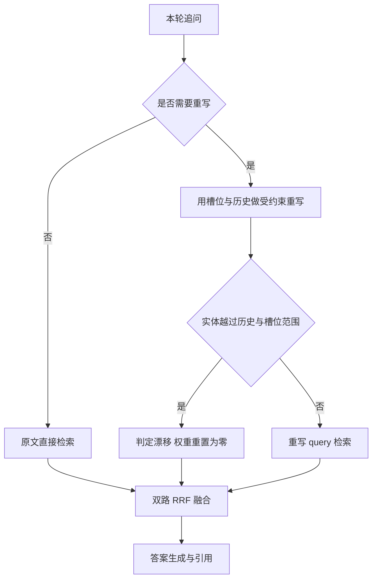

# 用户追问一句「那它保修多久」后检索就失灵：多轮 query 重写、漂移检测与回退怎么设计

## 为什么会有这个问题

对话式 RAG 的检索输入是本轮 utterance，而追问里普遍带指代和省略（它、这款、那保修呢），信息量极低，embedding 会落在语义空间的泛化区域，近邻全是「通用说明」类片段而不是用户真正在问的那个型号页。常见错误认知有三个：一是把最近 N 轮历史直接拼进 query 再 embed，历史噪声污染向量，且历史越长越糟；二是让 LLM 无约束重写，模型会把用户没说过的约束（版本、地区、场景）补进去，检索于是跑到别的主题上，症状是「重写后能召回，但答的是另一个东西」；三是重写后仍沿用原来的 answerability 阈值，漂移产生的错误召回被当成充分证据直接生成。本质问题是：重写是带增删的有损变换，必须可观测、可回退、可离线评估，而不能当成黑盒预处理。

## 怎么做

1. 判定是否值得重写：短 query、含指代/指示代词、上一轮是澄清或枚举、会话槽位缺关键实体时才触发；其余走原文直检，省掉一次 LLM 调用和一次不确定性。
2. 重写只做补全不做扩写：输出结构化结果 standalone_query 加 entities 列表，prompt 明确约束「只能使用 slots 与历史中已出现的实体，禁止新增」。
3. 维护会话级 slot store（产品、型号、版本、时间范围），重写优先用槽位拼装而非让模型自由生成，保证同一会话同一轮可复现、可 diff、可缓存。
4. 漂移检测不靠 LLM 判 LLM：拿重写出的 entities 与「历史实体并集 + 槽位值」做集合校验，只拦「新增了历史中未出现的实体」这一类高精度信号；命中即判漂移。
5. 双路检索 + 融合：原文 query 与重写 query 并行召回，用 RRF 融合，且重写那一路权重小于原文那一路（例如 1.0 对 0.8），漂移时直接置零回退，避免重写主导排序。
6. 离线评估建「多轮改写对」golden set：每条含正确的 standalone query 与应召回的 doc id，指标看重写后 Recall@k 相对原文直检的增益、漂移率、以及重写引入的错误实体数。
7. 线上埋点：重写前后 top-1 变化率、重写触发率、漂移率、多轮追问率；用它们判断问题出在重写质量还是检索本身。
8. 成本控制：重写用 small model 并设硬超时（如 300ms），超时或解析失败一律回退原文 query，绝不阻塞主链路。

## 关键代码

```python
import asyncio, re

PRONOUN = re.compile(r"(它|这个|那个|这款|该型号|上面)")
REWRITE = """把追问改写成可独立检索的 query。只允许使用 slots 与 history 中已出现的实体，禁止新增。
slots={slots}\nhistory={history}\nutt={utt}\n输出 JSON: {{"query": str, "entities": [str]}}"""

def need_rewrite(utt, slots):
    return len(utt) <= 20 or bool(PRONOUN.search(utt)) or not slots.get("product")

async def safe_rewrite(utt, slots, history, llm, timeout=0.3):
    try:
        out = await asyncio.wait_for(
            llm.json(REWRITE.format(slots=slots, history=history, utt=utt)), timeout)
    except Exception:
        return utt, False
    known = {v for v in slots.values() if v} | {e for h in history for e in h["entities"]}
    drifted = bool(known) and any(e not in known for e in out["entities"])
    return out["query"], drifted

def rrf(lists, weights, k=30):
    s = {}
    for w, ids in zip(weights, lists):
        for r, d in enumerate(ids, 1):
            s[d] = s.get(d, 0.0) + w / (k + r)
    return sorted(s, key=s.get, reverse=True)

async def turn_retrieve(utt, slots, history, retr, llm):
    q, w = utt, 0.0
    if need_rewrite(utt, slots):
        q, drifted = await safe_rewrite(utt, slots, history, llm)
        w = 0.0 if drifted else 0.8
    a, b = await asyncio.gather(
        retr(utt, 20), retr(q, 20) if w else asyncio.sleep(0, result=[]))
    return rrf([a, b], [1.0, w])
```

## 真实场景

某项目上线对话式知识库后出现稳定现象：首轮提问回答准确，从第二轮追问开始答错率明显上升。抽 trace 看到第二轮的重写 query 里出现了用户从未提过的地区与型号后缀，召回结果全是通用条款页；而把本轮原始短句直接检索，反而能命中正确的型号说明。进一步看埋点：重写触发率很高（因为追问普遍很短），漂移率也高，且重写那一路权重与原文相同，导致融合后错误片段排到了前面。另外重写调用偶发慢请求，把整个检索的 p99 拉长。排查路径是：先对比重写前后 query 文本与两路 raw rank，确认是重写扩写导致漂移；再核对融合权重与超时配置；最后用多轮 golden set 量化「原文直检 / 重写 / 双路融合」三档的 Recall@k，确认双路融合在保留增益的同时把漂移率压下去。

## 示意图



## 面试官追问

1. **Q：** 为什么不直接让 LLM 把整个多轮对话压成一个 query，而要维护槽位加增量重写？

   **A：** 整段压缩每次都要重新生成，同一会话同一轮两次调用结果可能不同，线上不可复现也无法 diff；成本随历史长度线性增长；而且压缩会把早期已确认的约束和历史噪声一起搅进去。槽位继承加增量重写让变量收敛在少数几个实体上，可缓存、可做集合校验、可回归测试。

2. **Q：** 漂移检测做成规则会不会漏判？

   **A：** 会，但这类设计的目标是高精度而不是高召回：只拦「新增了历史中未出现的实体」这种确定性信号，其余一律放行但给重写那一路降权。漏判的代价是融合结果偏一点，误判的代价是无条件丢掉有用的重写，后者更伤体验。所以宁可放过，交给排序权重和 answerability 判定兜底。


来源：https://github.com/guocong-bincai/ai-interview-guide/blob/main/docs/03-rag-system/README.md
