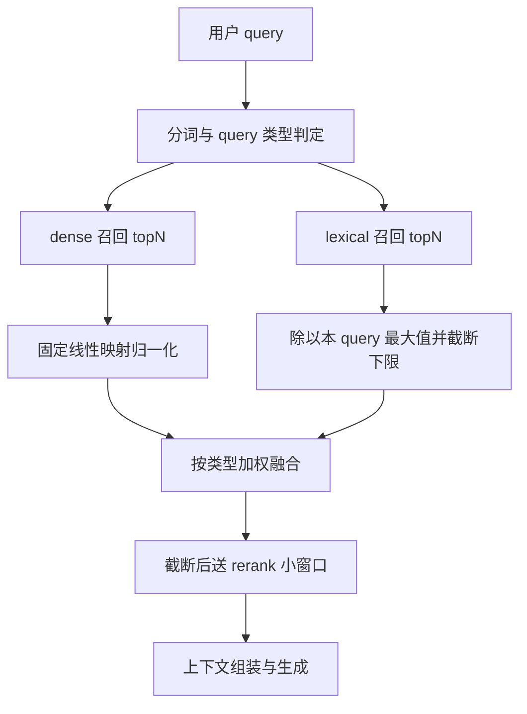

# dense 的 cosine 和 BM25 的分直接加权排序后，精确命中的那条反而掉出窗口：融合函数与分路深度怎么定

## 为什么会有这个问题

两路召回的分数根本不在一个量纲上：cosine 通常挤在很窄的高值区间，分布形状随语料变化很小；BM25 没有上界，随 query 长度、语料规模、分词结果漂移，同一个 query 换个索引版本最大值就换一个数量级。常见错误有三个：直接 0.7*cos + 0.3*bm25 加权求和，实际生效的权重由量纲决定而不是由业务意图决定；在单 query 内对每一路做 min-max 归一化，当某一路结果高度同质（max 与 min 很接近，典型是「全都不相关」或「全都相关」）时分母塌缩，微小噪声被拉成 0 和 1；以及认为 RRF 免调参，忽略了 k 决定名次衰减速度、分路深度不等时名次并不代表同等证据强度。表现出来就是：某一类 query 的正解明明在某一路排第一，融合后却被另一路大量「中等相似」的结果稀释掉。

## 怎么做

1. 先统一分路深度再谈融合：每路取相同的 top-N（N 明显大于最终需要的上下文条数），并对每路加分数下限截断（cosine 低于阈值、BM25 为 0 的直接不进融合），避免噪声参与名次竞争。
2. 选融合函数分两档：默认用 RRF（k 在 10~60 之间按 golden set 搜），它只依赖名次、对量纲不敏感、抗异常分数；只有当两路质量可比且需要保留分数强弱信息时才用加权分数融合。
3. 做分数融合必须用跨 query 稳定的归一化：dense 侧用固定的线性映射（门限 + 斜率），lexical 侧除以本 query 的 BM25 最大值或做 z-score，而不是 min-max；判断标准是「同一文档在不同 query 下的归一化分数可比较」。
4. 按 query 类型路由权重：含引号、型号、错误码、数字、专有缩写时提升 lexical 比重；自然语言长问句提升 dense 比重。路由只是调权重，两路都要跑，路由错了也还有回退空间。
5. 用 golden set 定参而不是靠体感：调参目标是「答案文档是否进 top-k」（Recall@5、MRR@10），对权重与 RRF k 做网格搜索，同时记录每路单独表现作为上界参照；不要用最终答案正确率当调参目标，噪声太大。
6. 埋点支持离线回放：记录每路 raw score、单路 rank、融合后 rank、分路贡献率；参数改动先在影子流量上对比再放量。
7. 把分数分布纳入监控：BM25 最大值分布发生整体位移往往意味着分词器、停用词或语料规模变了；cosine 分布整体下移往往意味着 embedding 版本或 query 分布变了，这类漂移会让固化下来的权重悄悄失效。

## 关键代码

```python
def minmax(scores):              # 反例：单 query 内归一化，分母易塌缩
    lo, hi = min(scores), max(scores)
    return [0.0 if hi == lo else (s - lo) / (hi - lo) for s in scores]

def fixed_map(cos):              # dense：固定映射，跨 query 可比
    return max(0.0, (cos - 0.55) / 0.40)

def lex_norm(bm25, q_max):       # lexical：除以本 query 的 max，保留相对强弱
    return 0.0 if q_max <= 0 else bm25 / q_max

def fuse(dense, lex, alpha=0.7, floor_lex=0.05):
    m = {}
    for doc, s in dense:
        m[doc] = m.get(doc, 0.0) + alpha * fixed_map(s)
    q_max = max([s for _, s in lex], default=0.0)
    for doc, s in lex:
        v = lex_norm(s, q_max)
        if v >= floor_lex:
            m[doc] = m.get(doc, 0.0) + (1 - alpha) * v
    return sorted(m.items(), key=lambda x: -x[1])

def rrf(lists, k=30, weights=None):
    weights = weights or [1.0] * len(lists)
    s = {}
    for w, ids in zip(weights, lists):
        for r, d in enumerate(ids, 1):
            s[d] = s.get(d, 0.0) + w / (k + r)
    return sorted(s, key=s.get, reverse=True)
```

## 真实场景

某内部文档检索系统出现一类稳定投诉：用户带着错误码或型号去搜，答案明明在库里，返回的前几条却是语义相近但压根不含这个标识符的段落。打日志发现，lexical 分路对这类 query 的第一名就是正确文档，但 dense 分路返回了一堆 cosine 都在中高区间的「主题相关」段落，两路加权后正确文档被挤到 rerank 窗口之外，而 rerank 只处理很短的候选列表，捞不回来。同时另一类长自然语言问句表现正常，说明不是检索能力问题而是融合层的问题。排查路径：先打印两路 raw score 与单路 rank、融合后 rank，确认是融合把 lexical 的第一名稀释掉；再用 golden set 扫 alpha 与 RRF k，观察精确类 query 与自然语言类 query 的指标此消彼长，最终用 query 类型路由加固定映射归一化解决，并把分路贡献率做成常驻看板。

## 示意图



## 面试官追问

1. **Q：** 为什么不用单 query 内的 min-max 归一化，它看起来最直观？

   **A：** 它的分母由本 query 的分数极差决定，当某一路结果高度同质（比如全是泛化段落，分数挤在一起）时极差趋近于零，排序里的微小抖动会被放大成 0 或 1，噪声直接顶到最前面。而且同一文档在不同 query 下拿到的归一化分数不可比，离线调出来的权重换一批 query 就失效，参数无法迁移。

2. **Q：** RRF 是不是就不用调参了？

   **A：** 不是。k 决定名次衰减速度，k 小则头部名次权重极端集中、k 大则趋于平均；更关键的是分路深度不等时名次不代表同等证据强度——一路返回上百条、另一路只返回十几条，后者的第 10 名和前者第 10 名的可信度完全不同。所以要么先把两路截断到相同深度，要么给每路一个先验权重，再谈 RRF。


来源：https://github.com/guocong-bincai/ai-interview-guide/blob/main/docs/06-vector-index-optimization/README.md
