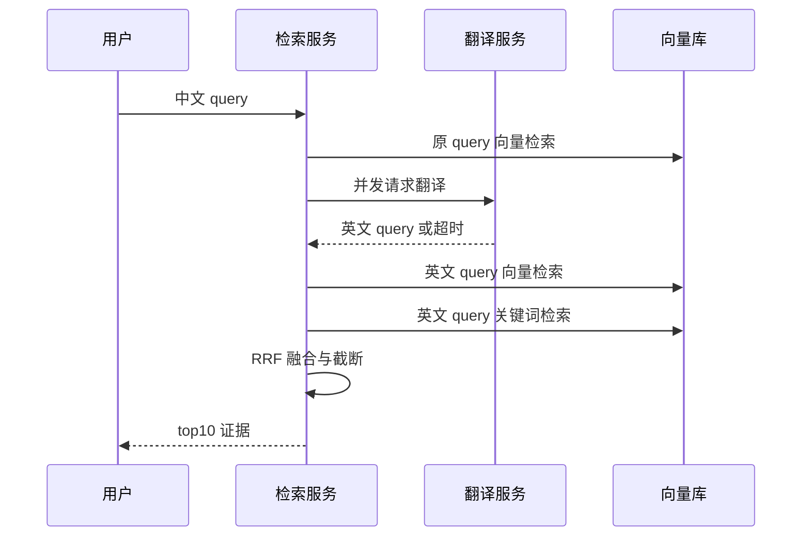

# 中文提问检索英文技术文档总是排不进 top10：跨语言对齐、分路检索与分层评估怎么落地

## 为什么会有这个问题

多语言 embedding 的跨语言对齐程度并不均匀：短中文 query 搭配英文 chunk 时，向量空间里的距离会整体偏大，而团队常常只看整体的 Recall@10，被占比较高的同语言文档兜住了指标，看不出问题。更隐蔽的是词法分支：BM25 使用中文分词器去匹配英文正文，命中率恒为 0，混合检索实际上退化成单路 dense，却没有报错。常见错误认知有两个：一是「换成多语言模型就好了」，但 query 侧没有做对称处理；二是「把全量文档先翻译成中文入库」，忽略了 O(N) 成本与每次文档更新都要重跑翻译的时延。此外，部分 chunk 本身就是中英混排（术语用英文、解释用中文），语言检测一旦误判，后续分路就全错。

## 怎么做

1. 先做语言对矩阵：把 query 语言和 chunk 语言两两分组，分别统计 Recall@k 与 MRR，再看词法分支的命中率是否为 0。先确认这是对齐问题、分词问题还是索引问题，不要急着换模型。
2. 对 query 侧做对称处理：先检测语言，再并发发起原 query 与译后 query 两路检索；翻译设 150-250ms 超时预算，超时或失败就退回单路，不要让翻译服务拖垮主链路。
3. 用自建平行 query 集做选型：同一个问题准备中英两个版本，标注同一个 gold chunk，比较各候选模型对「跨语言命中」的召回，而不是看 MTEB 平均分。
4. 词法分支按语言选择 analyzer：英文用 stem 加小写，中文用分词器；或用译后的 query 再补一路 BM25，权重按语言对分别标定，不要全局一套。
5. 索引侧给 chunk 打上 language 字段，分路检索或同集合内 filter 限定；中英混排的 chunk 按主体语言标注，并允许双语言标注。
6. 把语言对矩阵纳入例行回归：新增文档时校验 language 标注覆盖率，指标回落能第一时间发现。

## 关键代码

```python
import asyncio
from collections import defaultdict

def rrf(rank_lists, k=60, weights=None):
    weights = weights or [1.0] * len(rank_lists)
    score = defaultdict(float)
    for w, ranked in zip(weights, rank_lists):
        for pos, doc_id in enumerate(ranked):
            score[doc_id] += w / (k + pos + 1)
    return sorted(score, key=score.get, reverse=True)

async def dual_query_search(q, retriever, translator, budget=0.25, top_k=10):
    orig = await retriever.dense(q, top_k=50)
    try:
        en = await asyncio.wait_for(translator(q), timeout=budget)
    except Exception:
        return orig[:top_k]
    trans = await retriever.dense(en, top_k=50)
    lexical = await retriever.bm25(en, top_k=50, analyzer="en")
    return rrf([orig, trans, lexical], weights=[1.0, 1.0, 0.6])[:top_k]
```

## 真实场景

某项目知识库里约七成是英文 API 文档，三成是中文内部规范。用户用中文提问「限流失败后重试的退避策略配置在哪」，top10 里几乎全是中文规范里的泛泛描述，英文原文一次都没进窗口；用户手动把关键词换成英文重问才命中。离线整体 Recall@10 看上去正常，因为中文文档兜住了不少样本。排查路径：先按语言对拆指标，发现「中 query → 英 chunk」这一格明显偏低；再打印每路的候选数与分数分布，发现 BM25 分支返回为空，且 dense 相似度整体下移，并没有离群点；确认是对齐加分析器问题。改成双查询加英文 analyzer 后英文文档进入 top10，但要同时盯 p95 延迟，多出来的一路检索必须并行并带预算。

## 示意图



## 面试官追问

1. **Q：** 该把文档全量翻译入库，还是只在 query 侧翻译？

   **A：** 文档侧翻译是 O(N) 成本，且每次原文更新都要重跑并重建向量，好处是检索时单语、延迟低、结果可复用；query 侧翻译是 O(1)/请求，成本低但有延迟与失败率，译文质量直接影响召回。实践中以 query 侧为主，再对标题、摘要、高频 FAQ 做文档侧双语索引，兼顾成本与稳定性。

2. **Q：** 怎么判断多语言 embedding 值不值得换？

   **A：** 建中英平行 query 集，比较「跨语言命中率」以及各语言分桶的 Recall@10，同时看 tokenizer 对中文的 token 效率（直接影响成本）和向量维度带来的存储开销。换模型必须重建索引，所以要用影子集合灰度，对比线上真实 query 的 top10 重合度再决定切换。
