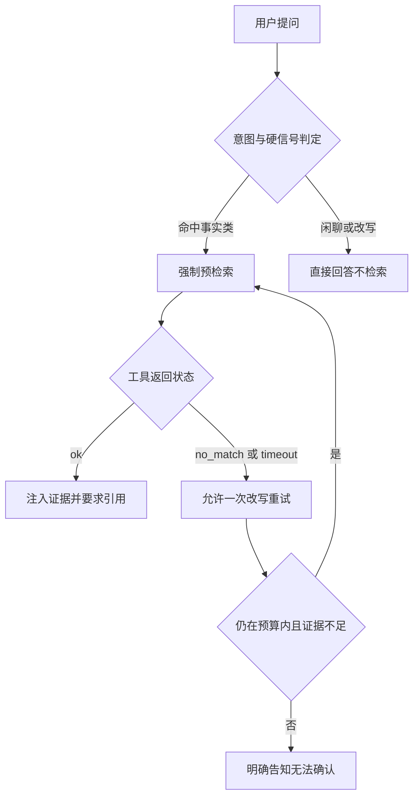

# 把检索从必走链路改成按需工具调用后，模型有时不查直接编、有时同一问题反复查：触发、幂等与预算怎么定

## 为什么会有这个问题

固定 pipeline 里检索是必走步骤，改成 Agent 按需调用 search_knowledge 之后，「要不要查」被交给了模型：它对自身知识边界的判断并不可靠，遇到价格、型号、审批流程这类参数化事实时倾向于直接作答；反过来，当工具返回的是一大段没有结构的长文本、也缺少「够不够」的信号时，模型会换着措辞反复检索。常见错误认知是「在 system prompt 里写一句先检索」就够了，实际触发判定需要确定性兜底信号；另外工具本身没有幂等和预算，重复调用会同时放大成本和尾延迟，还会让模型用最早那次的过期结果拼答案。再往上一层，知识（RAG）和流程（Skill）混在一起，模型分不清「查资料」和「走流程」该由谁负责。

## 怎么做

1. 触发分层：用正则、关键词或轻量意图分类器命中「最新、价格、政策、型号、流程节点」等硬信号，命中则强制预检索；其余交给模型自主决定，但在 system prompt 里明确「涉及具体事实必须先检索」。
2. 把工具契约写死：入参限定 query、top_k、时间范围、文档域；出参返回压缩 snippet、稳定的 chunk_id、最高分与状态枚举（ok / no_match / timeout / error），并显式告知「no_match 不等于不存在」。
3. 在单次请求内做幂等：把归一化后的 query 与过滤条件做哈希缓存，重复调用直接返回上次结果并附提示，要求基于已有证据作答或换更具体的问法。
4. 设硬预算：单会话最多 N 次检索、单次超时、总 token 预算；超预算后强制收敛为「基于已有证据回答或明确说明无法确认」，不再放行检索。
5. 可观测：记录 turn 级是否检索、调用次数、命中率、空结果比例、最终是否带 citation；离线准备「必须检索」与「不必检索」两类样本，评测触发准确率与漏检率。
6. 降级路径：检索超时时返回结构化错误而非空列表，避免模型把「没查到」误读成「公司没有这项政策」。

## 关键代码

```python
import asyncio, hashlib
from dataclasses import dataclass, field

@dataclass
class SearchBudget:
    max_calls: int = 3
    timeout_s: float = 2.0
    calls: int = 0
    cache: dict = field(default_factory=dict)

def norm(q, filters):
    raw = q.strip().lower() + repr(sorted((filters or {}).items()))
    return hashlib.md5(raw.encode()).hexdigest()

async def search_knowledge(query, top_k=5, filters=None, budget=None):
    key = norm(query, filters)
    if key in budget.cache:
        return {**budget.cache[key], "status": "cached",
                "hint": "同一 query 已检索过，请基于已有证据作答或换更具体的问法"}
    if budget.calls >= budget.max_calls:
        return {"status": "budget_exhausted", "hits": [],
                "hint": "检索次数已达上限，请基于已有证据回答或说明无法确认"}
    budget.calls += 1
    try:
        hits = await asyncio.wait_for(index.search(query, top_k, filters), budget.timeout_s)
    except asyncio.TimeoutError:
        return {"status": "timeout", "hits": [], "hint": "检索超时，不等于没有该信息"}
    res = {"status": "ok" if hits else "no_match",
           "max_score": max((h.score for h in hits), default=0.0),
           "hits": [{"chunk_id": h.id, "text": h.text[:400], "score": h.score} for h in hits]}
    budget.cache[key] = res
    return res
```

## 真实场景

某项目把固定的 RAG 链路改成 Agent 加检索工具后，整体 token 成本下降，但「答错政策条款」的投诉变多。拉 trace 看到两种极端：一类回答里根本没有 tool_call，模型凭参数化记忆写了型号和保修期；另一类对同一个问题连续检索四到五次，每次只换措辞，最后用的是最早那次的高分片段拼答案。排查路径：先统计 turn 级的工具调用分布（0 次占比、超过 2 次占比）、空结果率与带 citation 的回答占比，再抽查工具返回体，发现返回的是整段未压缩正文，且没有状态枚举，模型无法判断证据是否充分。改为硬信号强制预检索、返回结构化 snippet、加请求内幂等与调用上限后，两类问题都收敛。

## 示意图



## 面试官追问

1. **Q：** 强制预检索会不会让简单问题也走检索、拖高延迟？

   **A：** 先用意图分类或规则分流：闲聊、改写、格式调整直接跳过；事实类与含「最新、价格、流程」等硬信号的强制走。强制路径可以在模型首 token 之前就并行发起预取，命中后注入上下文，用户几乎感知不到额外延迟；真正的风险是预取拖慢首字，所以必须配超时与「检索未回先正常生成、回来再补证据」的降级。

2. **Q：** 如何避免模型把「检索为空」当成「公司没有这个政策」？

   **A：** 工具返回结构化 status，把 no_match、timeout、error 分开，并在 prompt 里明确三者语义不同；no_match 时允许一次改写重试（换措辞、放宽过滤条件或换文档域），仍在预算内无证据就输出「未找到相关文档，建议联系 X」，而不是给出否定结论。同时把 no_match 的 query 落到日志，作为知识缺口和切分策略的输入。


来源：https://github.com/guocong-bincai/ai-interview-guide/blob/main/docs/14-mcp-skill-systems/README.md
