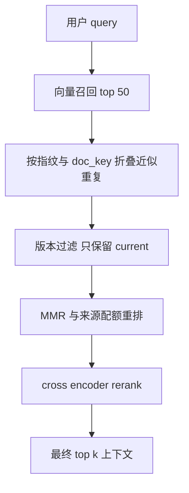

# 召回窗口被同一文档的多个版本和近似重复片段占满：去重指纹、版本收敛与多样性重排怎么设计

## 为什么会有这个问题

向量召回按 query 与单个 chunk 的相似度排序，它不理解"证据是否来自不同来源"。所以只要知识库里存在同一段落在多个版本、多个翻译稿、多个抓取副本里的重复出现，top-k 就会被同源近似重复内容占满：上下文预算被吃掉，模型只看到一种说法；一旦这个版本已废止，答案就整段错。常见的错误认知有两个：一是把 recall 当质量指标，但 recall@k 只回答"有没有命中"，不回答"证据够不够、是不是同一个来源"；二是入库时用正文哈希去重，正文相同但 version、doc_key 不同的副本哈希不同，近似重复（滑窗重叠、页眉页脚差异、全半角差异）根本去不掉。还有一个隐蔽点：相似度阈值对近似重复无效，因为它们的分数都极高，阈值只会误杀真正不同的长尾证据。

## 怎么做

1. 先把问题量化：从线上 dump 一段 query 的 top-50 召回，按 doc_key 或指纹分桶统计最大单桶占比、去重后的唯一证据数、context token 消耗；再建一个「需要多段证据才能回答」的小评估集（多条款、多套餐对比、多跳），用它区分单点事实题与多证据题的退化程度。
2. 入库侧做指纹与折叠：对 chunk 正文做归一化（NFKC、去空白、去页眉页脚模板、去 HTML 注释）后算 SimHash 或 MinHash 分桶，只在同一 doc_key 或同一来源簇内比较；簇内按 version、updated_at 或来源权威度选 canonical，其余标 dup_of 保留原文，检索时用 dup_of is null 过滤，不做物理删除以便审计回滚。
3. 版本收敛：同一逻辑文档用 doc_key 加 version 标识，默认只检索 is_current 为真的版本，历史对比场景通过 as_of 参数显式放开；归档版本打 archived 标记并在检索层默认排除。
4. 检索侧引入多样性重排：把候选扩到 30–50，用 rerank 分数作为相关性项做 MMR，或直接按 source、doc_key 设配额（每个来源最多 n 条），再取最终 top-k；注意 MMR 必须在 rerank 之后，否则会打乱 cross-encoder 的排序信息。
5. 按 query 类型路由：单点事实题走高相似度直取路径，避免多样性重排引入弱相关噪声；只有检测到对比、汇总、多跳意图时才启用配额与 MMR。
6. 灰度验证：A/B 对比唯一证据数、context token、答案正确率与引用覆盖率，特别确认没有把用户自己上传的同类文档误判为重复而整体过滤掉。

## 关键代码

```python
import numpy as np


def mmr_select(cands, k, lam=0.7, max_per_source=2):
    # cands: [{"id":..., "source":..., "score": rerank分, "vec": ...}]
    pool = sorted(cands, key=lambda c: -c["score"])
    selected, src_cnt = [], {}
    while pool and len(selected) < k:
        best, best_val = None, -1e9
        for c in pool:
            if src_cnt.get(c["source"], 0) >= max_per_source:
                continue
            red = max((float(np.dot(c["vec"], s["vec"])) for s in selected), default=0.0)
            val = lam * c["score"] - (1 - lam) * red
            if val > best_val:
                best, best_val = c, val
        if best is None:      # 配额卡死时放开配额兜底
            best = pool[0]
        selected.append(best)
        src_cnt[best["source"]] = src_cnt.get(best["source"], 0) + 1
        pool.remove(best)
    return selected
```

## 真实场景

某项目做客服知识库，产品手册每季度改版，旧版 PDF 不删只标 archived，另外还有一批运营上传的「手册摘录」。症状：用户问「这款保修多久」，top-8 里五条来自三份不同版本手册的同一段落，模型给出已废止条款；用户问「套餐 A 和套餐 B 差异」时，两个套餐各只挤进一条，答案只覆盖一边。排查路径：把该 query 的 top-50 召回 dump 出来按 doc_key 聚合，发现单 doc_key 占比过半；再对归一化正文做 SimHash，确认多条落在同一桶；接着核对评估集，多条款类问题正确率显著低于单点事实类，而 recall@10 一直很高——说明指标选错了层。修复后单 doc_key 占比下降、唯一证据数上升，多条款题正确率回升。

## 示意图



## 面试官追问

1. **Q：** MMR 会不会伤相关性和延迟？怎么定 λ？

   **A：** 会。MMR 是贪心 O(k·n)，n 扩到 50 也只是毫秒级，延迟主要来自候选扩大后的 rerank。λ 太小红（1-λ 权重大）会把弱相关片段拉进来，答案噪声反而变大。做法是在多证据评估集上扫 λ 取正确率拐点，同时保留单点事实题的直取路径做路由，避免全局退化。

2. **Q：** 入库去重会不会误删真正不同的文档？

   **A：** 所以要限定比较范围：只在同一 doc_key 或同一来源簇内做近似去重，跨来源的相同正文保留多条但共享同一 canonical 引用（转载场景需要溯源）。指纹阈值按领域调，且不做物理删除，保留 dup_of 字段可回滚、可审计。


来源：https://github.com/guocong-bincai/ai-interview-guide/blob/main/docs/03-rag-system/README.md
